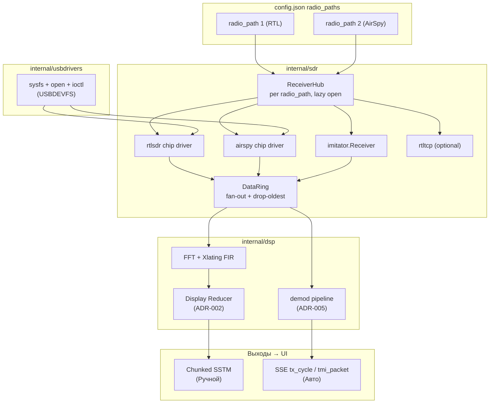

# ADR-006: SDR-драйверы и слой железа

**Дата:** 2026-06-17  
**Статус:** Accepted  
**Связанные ADR:** [ADR-002](ADR-002-binary-data-transport.md) (SSTM-транспорт), [ADR-004](ADR-004-operation-modes-and-station-schema.md) (Receiver + ScanStrategy), [ADR-005](ADR-005-reference-implementations.md) (референсы, лицензии, USB §2.4)  
**Связанные задачи:** PHASE-11 (SDR-001..006)

---

## 1. Контекст и проблема

ADR-004 определяет контракт `Receiver` (интерфейс SDR-устройства) и `ScanStrategy`, но не решает **как именно общаться с железом**. Текущий код `internal/sdr/` — только sysfs-перечисление USB-устройств и stub `Test()`. Live IQ-потока нет.

Задачи PHASE-11 в `tasks.md` устарели (SoapySDR, UDP/WebSocket, SSE waterfall) и противоречат ADR-002/004/005. Нужен ADR, фиксирующий:

- какие SDR поддерживаем и в каком порядке;
- два слоя драйвера (USB-транспорт ↔ протокол чипа);
- откуда берём код и паттерны;
- как данные текут от антенны до UI.

---

## 2. Решения

### 2.1. Pure-Go USB, zero CGO, только Linux

Согласовано с ADR-003 (предпочтение pure-Go зависимостей) и целью «один статический бинарь» для Raspberry Pi.

**Целевая платформа — только Linux.** USB-транспорт через USBDEVFS (ioctl). macOS/Windows не поддерживаются. `//go:build !linux` стабы — compile-guard, не целевая платформа.

**Отвергнуто:**

| Альтернатива | Причина отказа |
|---|---|
| SoapySDR | Системные libsoapysdr + плагины, ломает «один бинарь» и TDD |
| go-sdr (hz.tools) | CGO + librtlsdr, проект архивирован (2023) |
| go-fftw | CGO FFTW; FFT через gonum (pure Go) |
| GopherTrunk как `go get` | Тянет SQLite/TUI/trunking-декодеры; нужен только код chip drivers |

### 2.2. Два слоя SDR-драйвера

Ключевое архитектурное решение — **не смешивать** USB-транспорт и логику чипа.

| Слой | Пакет | Что делает | Источник |
|------|-------|------------|----------|
| **USB-транспорт** | `internal/usbdrivers/` | sysfs enumeration, open device node, `USBDEVFS_CONTROL`, `CLAIMINTERFACE`, bulk read/write | **Самописный** (clean-room). Референсы: [pzl/usb](https://github.com/pzl/usb), [kevmo314/go-usb](https://github.com/kevmo314/go-usb), kernel `usbdevice_fs.h` |
| **Протокол чипа** | `internal/sdr/chipdrivers/rtlsdr/` и др. | Vendor requests, tune, gain, activate stream, конвертация raw→`complex64` | Порт/адаптация из [GopherTrunk](https://github.com/MattCheramie/GopherTrunk) (Apache-2.0) + osmocom rtl-sdr wiki |

**USB-транспорт пишем сами** — для понимания Linux usbfs и системного программирования. Подробности: ADR-005 §2.4.

Структура `internal/usbdrivers`:

```text
internal/usbdrivers/
├── sysfs.go           # перечисление устройств (/sys/bus/usb/devices)
├── device.go          # Open(path), Close, ClaimInterface
├── control.go         # ControlTransfer (USBDEVFS_CONTROL)
├── bulk.go            # BulkRead / BulkWrite (USBDEVFS_BULK)
├── ioctl_linux.go     # //go:build linux — константы ioctl
└── *_linux_test.go    # unit-тесты sysfs; live-тесты с dongle
```

### 2.3. Единый внутренний формат IQ — `complex64`

Все драйверы конвертируют свой нативный формат при чтении:

| Драйвер | Нативный формат | Конвертация |
|---------|-----------------|-------------|
| RTL-SDR | `uint8` пары (I, Q) | `(sample - 127.5) / 127.5` → `complex64` |
| AirSpy | `int16` пары | `sample / 32768.0` → `complex64` |
| Имитатор (`internal/sdr/imitator`, driver `simulated`) | `complex64` (синтетический тон или replay `.cfile`) | без конвертации |

### 2.4. rtl_tcp — опциональный backend

Оставляем как **удалённый RTL** (`driver: "rtltcp"`, host/port в `ReceiverConfig`). Полезно для антенны «на крыше». Локальный USB — приоритет MVP.

### 2.5. Multi-device roadmap

| Этап | Железо | ScanStrategy | Capabilities |
|------|--------|--------------|--------------|
| **MVP** | `simulated` + `rtlsdr` USB | `HopAndDwellStrategy` | max BW ~2.4 MSPS |
| **+1** | `rtltcp` | HopAndDwell | как RTL |
| **+2** | `airspy` R2/Mini | `ChannelizerStrategy` | до 10 MSPS, `SupportsParallel: true` |
| **+3** | `hackrf`, `airspyhf` | Channelizer / отдельный HF-тракт | по datasheet |
| **Вне скоупа v1** | SDRplay, USRP, BladeRF | — | Требуют vendor C SDK |

Выбор стратегии — автоматически по `Receiver.Capabilities().MaxBandwidthHz` (ADR-004 §2.3).

---

## 3. Архитектура



### 3.1. Новые пакеты

*(имена синхронизированы с кодом Этапа B, 2026-07-17)*

| Пакет | Роль | Источник паттерна | Статус |
|-------|------|-------------------|--------|
| `internal/usbdrivers/` | sysfs → open → control → bulk ioctl | Самописный (ADR-005 §2.4) | ⏳ Этап C |
| `internal/sdr/receiver.go` | Интерфейс `Receiver`, `IQFrame`, `Capabilities`, `StreamConfig` | ADR-004 §2.3 | ✅ |
| `internal/sdr/chipdrivers/` | Registry + `rtlsdr`, `airspy`, `rtltcp` | GopherTrunk chip drivers | ⏳ Этап C |
| `internal/sdr/imitator/` | Синтетический тон + replay `.cfile` из `io.Reader` (TDD без железа) | sdr-modem replay | ✅ |
| `internal/sdr/receiver_hub.go` | `ReceiverHub`: 1 приёмник на `radio_path`, lazy open через фабрику | sdr-server lazy-start | ✅ |
| `internal/sdr/ring.go` | `DataRing`: кольцевой буфер **с fan-out** (1 writer → N подписчиков, drop-oldest) — поглотил планировавшийся отдельный `iqtap` | sdr-server `queue.png` + GopherTrunk `iqtap` | ✅ |
| `internal/dsp/` | FFT (gonum), xlating FIR, reducer, pipeline | sdr-server + ADR-002 | ⏳ Этап D |
| `internal/handlers/stream_handler.go` | `/api/stream/v1/*` (SSTM) | ADR-002 | ⏳ Этап D |

### 3.2. Расширение `ReceiverConfig`

Новые поля в `internal/config/types.go` (к уже существующим `Driver`, `Serial`, `DevicePath`, `Label`):

```go
type ReceiverConfig struct {
    Driver       string `json:"driver,omitempty"`
    Serial       string `json:"serial,omitempty"`
    DevicePath   string `json:"device_path,omitempty"`
    Label        string `json:"label,omitempty"`
    // --- новые поля ---
    CenterFreqHz uint64 `json:"center_freq_hz,omitempty"` // стартовая частота тракта (было defaults в ADR-004)
    SampleRateHz uint32 `json:"sample_rate_hz,omitempty"`
    Gain         string `json:"gain,omitempty"`        // "auto" или значение в dB
    PPM          int    `json:"ppm,omitempty"`          // коррекция частоты (RTL)
    BiasTee      bool   `json:"bias_tee,omitempty"`
    RtlTcpHost   string `json:"rtltcp_host,omitempty"`
    RtlTcpPort   int    `json:"rtltcp_port,omitempty"`
}
```

Gain в **dB** (UX), конвертация в tenths-dB — внутри RTL chip driver.

> Это **единственное** определение расширенного `ReceiverConfig` в документации: блок `defaults{…}` из ранней редакции ADR-004 §2.2 заменён плоскими полями. Источник правды по текущему состоянию — `internal/config/types.go`.

### 3.3. Интеграция с существующим API

- `GET /api/sdr/devices` — сохранить, дополнить реальным open/read в `Test()`.
- Новые (единый набор с ADR-002 ч.III, 2026-07-17):
  - `POST /api/sdr/tune` `{radio_path, center_hz, span_hz, gain_db?}` — перестройка приёмника тракта;
  - `GET /api/sdr/status?radio_path=…` — текущая конфигурация приёмника.
- Chunked streams — по протоколу ADR-002 (без изменений).

---

## 4. Атрибуция

Правила копирования кода — ADR-005 §2.3 (таблица «Источник → Как»).

При порте chip drivers из GopherTrunk (Apache-2.0) — атрибуция в заголовке файла:

```go
// Адаптировано из GopherTrunk rtlsdr/ (Apache-2.0), <SHA-короткий>.
// https://github.com/MattCheramie/GopherTrunk
```

Глобальный `NOTICE` в корне репо — секция GopherTrunk.

USB-транспорт (`internal/usbdrivers`) — clean-room, NOTICE не нужен. Атрибуция только при копировании конкретных фрагментов из референсов (pzl/usb — MIT, kevmo314/go-usb — Apache-2.0).

---

## 5. Этапы реализации

### Этап A — ADR + каркас (текущий)

1. ✅ Этот ADR (`ADR-006`).
2. Обновить `NOTICE` — секция GopherTrunk.
3. Переписать PHASE-11 в `tasks.md` под ADR-004/002/006.

### Этап B — SDR-001: Receiver + имитатор + ring ✅ (TDD, без железа)

1. ✅ Интерфейс `Receiver` + типы `IQFrame`, `Capabilities`, `StreamConfig` в `internal/sdr/receiver.go`.
2. ✅ `imitator.Receiver` — синтетический тон + replay `.cfile` из `io.Reader`.
3. ✅ `DataRing` — fan-out кольцевой буфер, drop-oldest (race clean).
4. ✅ `ReceiverHub` — привязка `radio_path` → receiver instance, lazy open; wiring в `app.go`.

### Этап C — SDR-001: usblinux + RTL-SDR USB (с железом)

1. `internal/usbdrivers`: sysfs (перенос из `discover_linux.go`), open, control transfer, claim interface, bulk read.
2. `internal/sdr/chipdrivers/rtlsdr`: chip protocol — порт/адаптация из GopherTrunk.
3. `Test()` — реальное open/tune/read 256 samples.
4. udev/blacklist — в README проекта.

### Этап D — SDR-002 + транспорт

1. `internal/dsp`: FFT (gonum), xlating FIR (порт sdr-server).
2. Display Reducer → `stream_handler.go` `/spectrum`, `/panorama`.
3. Подключение фронта (MANUAL-002).

### Этап E — SDR-004/005 + live Авто

1. Doppler multiply в pipeline.
2. `HopAndDwellStrategy` → live `tx_cycle` (замена `TxCycleMock`).

### Этап F — AirSpy (+ HackRF по запросу)

1. Порт `airspy` driver.
2. `ChannelizerStrategy` — параллельные VFO на одной полосе.

---

## 6. Открытые вопросы

| ID | Вопрос | Предложение |
|----|--------|-------------|
| Q-H1 | Vendoring vs постепенный порт chip drivers GopherTrunk | Копировать минимальный набор (`rtlsdr/`, `airspy/`) в `internal/sdr/chipdrivers/`, не submodule |
| Q-H2 | CGO fallback для USRP/SDRplay | Явно out-of-scope v1; пересмотр только при запросе |
| Q-H3 | SIMD для FFT | v1 без SIMD; позже `golang.org/x/sys/cpu` по ADR-005 §7.1 |

---

## 7. Что не делать

- Не подключать `hz.tools/sdr` / `go-fftw` как зависимости.
- Не делать SoapySDR wrapper.
- Не слать сырой IQ на UI (только `/iq` diagnostic + запись файла).
- Не смешивать trunking-логику GopherTrunk с cubesat pipeline.

---

## 8. Критерии успеха MVP (RTL-SDR)

1. `POST /api/sdr/test` с `driver=rtlsdr` — open + read IQ OK.
2. Ручной режим: `/api/stream/v1/spectrum` отдаёт SSTM FFT ≥15 FPS при 2 MSPS.
3. `imitator.Receiver` + replay file — `go test ./internal/sdr/...` проходит без железа. ✅
4. Переключение `radio_path` в config не ломает другой тракт (изолированные pool entries).
