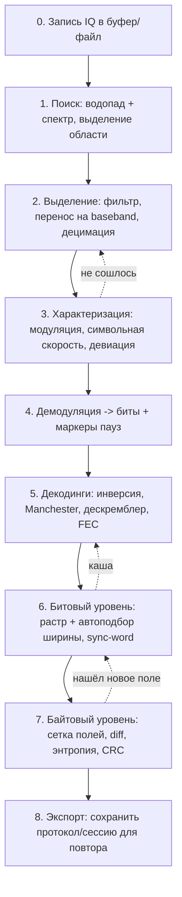

# ADR-007: Лаборатория сигнала — офлайн-анализ незнакомой телеметрии

**Дата:** 2026-07-21  
**Статус:** Accepted  
**Связанные задачи:** PHASE-12 (DEMOD-001..006), SIGLAB-001..005, MODE-ANALYSIS-001
**Связанные ADR:**
- ADR-004 (Режимы работы) — закрывает открытый вопрос §12 п.4 «Запись baseband для offline-обработки»; **Анализ — третий равноправный режим** (ADR-004 §2.1), а не подрежим Ручного.
- ADR-005 (Референсные реализации) — поставляет DSP/демод/FEC/парсеры (jradio, samoyed, gr-satnogs, satnogs-decoders, Kaitai); этот ADR добавляет референсы по **анализу** (URH, SigDigger, inspectrum).
- ADR-002 (Бинарный транспорт) — декодированные кадры идут через SSE (JSON), сырой IQ/replay — вне SSE.
- ADR-006 (SDR-драйверы) — источник IQ для записи.

---

## 1. Контекст и проблема

### 1.1. Существующий демодулятор работает только по известным форматам

Реализованный (и планируемый) в PHASE-12 тракт `демод → декодер → парсер ТМИ` рассчитан на **известные** протоколы: AX.25, CCSDS, `.ksy`-декодеры конкретных КА (ADR-005 §3.2). Если сигнал незнаком — новый метеоспутник, экспериментальный кубсат, unknown-несущая (ADR-004 §8.3) — обычный демодулятор его не берёт: неизвестны модуляция, символьная скорость, кодирование, структура кадра.

### 1.2. Оператору нужен инструмент реверса

Задача, которую сформулировал пользователь: **визуально отображать работу демодулятора и подсвечивать паттерны в принятых данных**, чтобы анализировать незнакомые форматы ТМИ / метеоспутников. Исходная аналогия — hex-редактор: слева hex, справа интерпретация. При проработке аналогия развилась до полноценной среды анализа сигнала по трём уровням абстракции.

### 1.3. Ключевое наблюдение: анализ незнакомого сигнала — офлайн-процесс

Подбор параметров незнакомого сигнала — это десятки итераций «изменил настройку → пересчитал → посмотрел» на **одних и тех же** сэмплах. В реальном времени так нельзя: пролёт длится минуты, второго шанса до следующего витка нет. Значит нужен **буфер записи IQ + replay**, а сам разбор идёт по записи. Live-приём и анализ — два разных подрежима.

Это закрывает открытый вопрос ADR-004 §12 п.4 и делает решение из «сохранение IQ в файл» полноценной фичей.

---

## 2. Принятые решения (обзор)

| # | Решение |
|---|---------|
| 2.1 | **Режим «Анализ»** — «Лаборатория сигнала» (offline-анализ записанного IQ). Третий равноправный режим в mode-bar (изначально задумывался подрежимом Ручного). Имя «Форензика» отклонено. |
| 2.2 | **Запись IQ + replay** — обязательный фундамент. Live-водопад только находит сигнал; анализ — по записи. |
| 2.3 | **Три уровня представления**: физический (созвездие/глаз/гистограммы), битовый (растр + автоподбор ширины), байтовый (сетка полей в стиле URH). |
| 2.4 | **Строгое разделение Go↔JS**: вся логика (DSP, демод, декодинги, автоподбор, сегментация, diff, CRC) — на бэкенде. JS — «тупой» рендерер. |
| 2.5 | **Контракт SSE** для декодированных кадров: `frame_decoded` + `field_schema` + `analysis_state`. |
| 2.6 | **Doppler-коррекция по TLE при replay** — уникальная фича, TLE/SGP4/`range_rate` уже есть в проекте. |
| 2.7 | Компоновка: компактная тройка (созвездие/глаз/гистограммы) — в **табы**; временна́я область (осциллограмма, мгновенная частота, пачки) — на первый план. |
| 2.8 | Заимствования из URH, SigDigger, inspectrum, gr-satellites зафиксированы в §7 (брать/пропустить). |
| 2.9 | **Формат записи IQ — SigMF** (`.sigmf-data` + `.sigmf-meta`), а не собственный контейнер. См. §2.9. |

### 2.9. Запись IQ в формате SigMF

Решение 2026-08-11. Записи храним в [SigMF](https://github.com/sigmf/SigMF): бинарный `.sigmf-data` рядом с JSON-метаданными `.sigmf-meta`.

**Почему не свой формат:**

- Записи открываются сторонними инструментами (inspectrum, SatDump, GNU Radio, URH) — можно сверять результат нашего анализа с эталоном.
- Метаданные стандартизованы: `core:datatype`, `core:sample_rate`, `core:frequency`, `core:datetime`. Не нужно изобретать заголовок.
- Формат сэмплов кодируется в `core:datatype` (`ci8`, `ci16_le`, `cf32_le`), поэтому выбор cs8/cs16/cf32 перестаёт быть решением уровня ADR — это поле в метаданных.
- Многосегментность (`captures[]`) штатно описывает смену частоты/sample rate внутри одной записи — ровно случай политики `SWEEP` из ADR-004 §2.4.

**Наши расширения** — в отдельном namespace, чтобы не ломать совместимость: NORAD-ID, имя КА, `radio_path`, TLE на момент записи (нужен для Doppler-replay по §6.3).

**Следствие для ADR-006:** replay становится обычной реализацией `Receiver` (виртуальный приёмник поверх SigMF-файла), а не отдельной веткой кода. Имитатор уже умеет replay `.cfile` из `io.Reader` — добавляется чтение `.sigmf-meta` и выбор `datatype`. Живой приём и воспроизведение проходят один и тот же конвейер.

**Что остаётся за SIGLAB-001:** лимит длительности/размера кольцевого буфера и `datatype` по умолчанию (кандидат — `ci8` для RTL-SDR, нативный формат без конвертации).

---

## 3. Сценарий работы оператора (8 стадий)

Сквозной сценарий «получил незнакомый сигнал → понял формат». Стадии выполняются итеративно, с возвратами.



### Описание стадий

| Стадия | Что делает оператор | Что считает бэкенд (Go) |
|--------|---------------------|-------------------------|
| **0. Запись** | В Ручном (live) жмёт «Запись», пишет пролёт незнакомого сигнала | Кольцевой буфер IQ + дамп в SigMF (§2.9); метаданные (центр, sample rate, время, TLE-контекст) |
| **1. Поиск** | Открывает запись, крутит replay, выделяет область на водопаде (частота × время) | Детектор активности (энергия+длительность), сегментация пачек (burst detector) |
| **2. Выделение** | Задаёт центр/полосу канала, извлекает срез | Bandpass, перенос на 0 Гц (frequency xlating), децимация, DC-removal, нормализация |
| **3. Характеризация** | Смотрит осциллограмму/мгновенную частоту/гистограмму уровней, оценивает модуляцию и скорость (в т.ч. курсорами) | Оценка типа модуляции, символьной скорости (автокорреляция/Gardner), девиации/разноса тонов, смещения несущей, SNR |
| **4. Демодуляция** | Выбирает модуляцию и параметры, получает биты + маркеры пауз | Демодуляторы FSK/PSK/OOK (ADR-005 §3.2), clock recovery, слайсер soft→hard |
| **5. Декодинги** | Собирает цепочку декодингов, пробует варианты | Инверсия, NRZI/Manchester, дескремблер (CCSDS PN / G3RUH), FEC (Витерби, Рид-Соломон) |
| **6. Битовый** | Смотрит битовый растр, подтверждает/фиксирует ширину кадра | Автоподбор ширины (§5), поиск синхрослова/ASM, определение сдвига столбцов |
| **7. Байтовый** | Размечает поля, включает diff/энтропию, проверяет CRC, интерпретирует значения | Сегментация полей, diff между кадрами, энтропия по столбцам, детект/брутфорс CRC, интерпретаторы значений |
| **8. Экспорт** | Сохраняет найденный протокол/сессию | Сериализация описания протокола (в т.ч. черновик `.ksy`), экспорт bits/bytes/CSV/KISS |

---

## 4. Компоновка UI

### 4.1. Расположение

**Отдельная страница `/analysis`**, третий режим в mode-bar рядом с Авто и Ручным (`mainMode: 'analysis'`, CSS-класс `mode-analysis`, ADR-004 §6). **Не** смешивается с live-layout Ручного (ADR-004 §4.3): там поток «сейчас», здесь — работа с записью.

**Доступен при любом типе станции, включая `basic`** (нет радиотрактов): разбор готовой записи не требует железа. Кнопка `REC` в шапке при этом неактивна — доступна только загрузка существующей записи.

**Вход в режим:** из Ручного после записи сигнала (ADR-004 §4.4, политика панорамы `HOLD`) — оператор переключается на «Анализ», запись подхватывается как текущая. Либо напрямую, с выбором ранее сохранённой записи.

Полный визуальный референс: `docs/img/signal-lab-full-page-mockup.png`.

### 4.2. Секции страницы (сверху вниз)

| # | Секция | Состав | Стадии |
|---|--------|--------|--------|
| — | **Шапка** | `▶ REPLAY`, имя записи, таймлайн-скраббер, скорость воспроизведения, индикатор `Doppler: ON (TLE)`, кнопка `REC` | 0 |
| 1 | **Поиск сигнала** | Мгновенный спектр + водопад, рамка выделения (частота×время), курсоры измерения символьной скорости | 1 |
| 2 | **Временна́я область** | Осциллограмма I/Q, график мгновенной частоты, полоса пачек | 2–3 |
| 3 | **Табы (компактно)** | `Созвездие \| Глаз \| Гистограмма уровней \| Профиль ширины` | 3, 6 |
| 4 | **Битовый уровень** | Битовый растр + контрол «Бит/строку (авто)» | 6 |
| 5 | **Байтовый уровень** | Сетка полей (URH-стиль), тумблер `diff`, `Bits/Hex/ASCII`, выпадашка декодинга, легенда полей, панель «Значения полей» | 7 |

> **Обоснование табов (2.7):** созвездие, глаз и гистограммы редко нужны одновременно — их в компактный фрейм с вкладками. Временна́я область (осциллограмма, мгновенная частота, пачки) полезнее для понимания структуры — её на первый план. Логика та же, что в URH: сначала сигнал во времени, потом углубление.

Референсы отдельных фрагментов:
- `docs/img/signal-lab-layers-mockup.png` — три уровня (физический / битовый / байтовый) единой панелью.
- `docs/img/signal-lab-analysis-grid-mockup.png` — крупный план байтового уровня (сетка полей, diff, CRC, интерпретаторы).

---

## 5. Автоподбор ширины кадра (битовый уровень)

Битовый растр — чёрно-белая картинка, где 1 бит = 1 пиксель, ширина строки = предполагаемая длина кадра. При совпадении ширины константные поля (преамбула, sync, счётчики-константы) встают в вертикальные полосы.

### 5.1. Ширина подбирается автоматически (инкрементально)

С приходом каждой пачки бэкенд пересчитывает оценку и предлагает ширину; оператор может зафиксировать вручную.

| Метод | Что по оси Y | Корректное имя элемента |
|-------|--------------|-------------------------|
| Постоянство столбцов `score(W) = Σ \|p−0.5\|` | оценка 0..1 | **профиль подбора ширины** |
| Автокорреляция битов по лагам | коэффициент корреляции | коррелограмма |
| Расстояния между синхрословами | число попаданий | **гистограмма ширин** |

> **Терминология (зафиксировано в обсуждении):** «спектр ширин» — неверно (ось X — ширина, не частота). Название зависит от алгоритма: `score(W)` → «профиль», распределение расстояний между sync → «гистограмма». В UI-табе используется нейтральное «Профиль ширины».

**Инкрементальность:** копим биты в кольцевом буфере, пересчитываем по дебаунсу (раз в пачку / N мс), меняем зафиксированную ширину только с **гистерезисом** (чтобы растр не «дёргался»). Пики профиля кликабельны — ручной override.

---

## 6. Разделение ответственности и контракт данных

### 6.1. Go считает — JS рисует (2.4)

Вся тяжёлая логика — на бэкенде: DSP (фильтры, перенос, децимация), демодуляция, цепочка декодингов, автоподбор ширины, сегментация полей, diff, энтропия, CRC. Фронтенд (canvas + DOM) только отрисовывает и маппит `field → цвет`. Причины: единый источник правды, тестируемость по TDD (ADR-005 §5), переиспользование алгоритмов PHASE-12, отсутствие дублирования DSP на JS.

### 6.2. Контракт SSE (2.5)

Декодированные кадры — не высокочастотный поток (в отличие от FFT/IQ, ADR-002), поэтому идут через **SSE как JSON-события**, а не chunked-stream. Само воспроизведение записи идёт через chunked-stream `GET /api/stream/v1/replay` (ADR-002, часть III «Транспорт режима Анализ»; `radio_path` не нужен, поэтому режим работает и при `station_type = basic`).

**`field_schema`** — словарь полей (шлётся при смене разметки, не в каждом кадре):

```json
{
  "type": "field_schema",
  "fields": {
    "preamble": { "label": "Preamble", "color": "#FFF3A0", "type": "hex" },
    "sync":     { "label": "Sync",     "color": "#E0A0FF", "type": "hex" },
    "length":   { "label": "Length",   "color": "#B6F0B6", "type": "dec" },
    "crc":      { "label": "CRC",      "color": "#F0B860", "type": "hex" }
  }
}
```

**`frame_decoded`** — один декодированный кадр (JS только раскрашивает):

```json
{
  "type": "frame_decoded",
  "id": 3,
  "timestamp_s": 9.20,
  "decoding": "ccsds_descramble",
  "cells": [
    { "hex": "aa", "bits": "10101010", "ascii": ".", "field": "preamble" },
    { "hex": "2d", "bits": "00101101", "ascii": "-", "field": "sync" }
  ],
  "diff_mask": [false, false, true],
  "crc_ok": true
}
```

**`analysis_state`** — агрегаты для служебных панелей: подобранная ширина, профиль `score(W)`, символьная скорость, SNR, энтропия payload, статистика кадров/CRC, найденный полином CRC.

> `bits`/`ascii` бэкенд отдаёт готовыми (принцип 2.4). Формирование hex/ascii из бит — тривиальный рендеринг, но во избежание расхождений считает бэкенд.

### 6.3. Doppler-коррекция при replay (2.6)

При воспроизведении записи бэкенд снимает доплеровский сдвиг несущей по орбите: TLE/SGP4 уже в проекте, `range_rate` уже в SSE (см. CLAUDE.md, ADR-005 §3.1 `SDR-004`). Паттерн `DopplerValueSource + Multiply` (умножение IQ на комплексную экспоненту) применяется к записанному потоку по временно́й метке. Это **уникальное преимущество** относительно URH/SigDigger общего назначения: у нас есть орбитальный контекст записи.

---

## 7. Заимствования из инструментов реверса (брать / пропустить)

Источники идей: [URH](https://github.com/jopohl/urh) (архивирован 2026-03, зрелый), SigDigger (BatchDrake), inspectrum, [gr-satellites](https://github.com/daniestevez/gr-satellites) (Daniel Estévez).

### 7.1. URH — Universal Radio Hacker

| Идея | Решение | Куда |
|------|---------|------|
| Фаза **Interpretation**: `Bits/Hex/Analog`, маркеры пауз `[Pause: N]` | Брать | Секции 1–2, битовый уровень |
| Фаза **Analysis**: выровненная сетка кадров, цветные поля, линейка позиций | **Брать (ядро)** | Секция 5, `docs/img/signal-lab-analysis-grid-mockup.png` |
| Режим **diff** («Mark diffs in protocol») | **Брать** — ключ к поиску счётчиков/таймстемпов vs констант | `diff_mask` |
| Панель значений выбранного кадра (label values) | Брать | «Значения полей» |
| **Customizable decodings** (invert, differential, whitening) | Брать **как конструктор цепочки**, не хардкод | Стадия 5 |
| Fuzzing, Generator, Simulator, TX-атаки | **Пропустить** — приёмная станция, не передача/взлом | — |

### 7.2. SigDigger

| Идея | Решение | Куда |
|------|---------|------|
| **Doppler-коррекция по TLE** | **Брать (киллер-фича)** — данные уже есть | §6.3 |
| **Symbol sampler / grid символов** | Брать — растр на уровне символов до слайсинга | Битовый уровень / табы |
| **Гистограмма уровней отсчётов** (число уровней → порядок модуляции, пороги) | **Брать** (дёшево, наглядно) | Таб «Гистограмма уровней» |
| Costas/AFC, clock recovery с индикацией захвата | Брать позже | Стадия 4 |

### 7.3. inspectrum

| Идея | Решение | Куда |
|------|---------|------|
| **Курсоры измерения символьной скорости** прямо на водопаде | **Брать** | Секция 1 |
| Производные графики из выделения (амплитуда/частота/фаза) | Брать | «Мгновенная частота» и др. |
| Регулировка FFT / контраста / zoom водопада (power min/max) | Брать | Секция 1 |

### 7.4. gr-satellites

| Идея | Решение | Куда |
|------|---------|------|
| **Реестр декодеров по спутнику** (авто-применение по NORAD) | Брать как концепцию | Стадия 8, связка с Планом сеансов |
| **CCSDS-кубики**: ASM `1ACFFC1D`, дескремблер PN, Витерби, Рид-Соломон | **Брать** — без них реальная ТМИ = каша | Стадия 5 (реализация — ADR-005) |
| Вывод KISS/beacon, submit в SatNOGS | Позже | Стадия 8 |

### 7.5. Топ-5 «взять обязательно»

1. Doppler-коррекция по TLE при replay (SigDigger) — синергия с проектом.
2. Курсоры измерения символьной скорости на водопаде (inspectrum).
3. Гистограмма уровней отсчётов → порядок модуляции (SigDigger).
4. Symbol grid / битовый растр с автошириной (SigDigger + идея пользователя).
5. CCSDS-кубики декодинга (gr-satellites).

### 7.6. Что сознательно НЕ берём

Fuzzing, генерация/передача сигналов, симуляция протоколов, GNU-Radio-подобный flowgraph-редактор — избыточно для приёмной станции, раздувает скоуп.

---

## 8. Параметры, выводимые в UI (по секциям)

Полный перечень настраиваемых/отображаемых параметров — то, что «нужно вывести».

| Секция | Параметры (настройка) | Параметры (индикация) |
|--------|-----------------------|-----------------------|
| Шапка/replay | скорость воспроизведения, позиция таймлайна, Doppler on/off, источник TLE, кнопка REC | имя файла, длительность, sample rate, центр, время записи (UTC) |
| 1. Поиск | размер FFT, окно, контраст (min/max dB), усреднение, выделение (частота+время) | RBW, span, курсоры → символьная скорость |
| 2. Выделение | центр-offset, полоса, децимация, тип фильтра/число отводов, DC-removal, нормализация/AGC | длина среза, эфф. sample rate |
| 3. Характеризация | тип модуляции (авто/ручной), символьная скорость, отсчётов/символ | девиация/разнос тонов, смещение несущей, SNR, уровни гистограммы |
| 4. Демодуляция | модуляция, центр, bit length (отсч/символ), error tolerance, порог слайсера, инверсия | Lock, качество глаза |
| 5. Декодинги | цепочка (инверсия, differential, NRZI/Manchester, дескремблер+полином, FEC-тип), sync/ASM | статус декодинга, длина после FEC |
| 6. Битовый | бит/строку (авто/ручн.), метод профиля, сдвиг столбцов (roll) | подобранная ширина, профиль `score(W)`, sync-word |
| 7. Байтовый | порядок байт (MSB/LSB), разметка полей, diff on/off, энтропия on/off, CRC (полином/ширина/init/xorout/reflect), интерпретаторы (тип/endianness) | кадров, ошибки CRC %, энтропия payload, найденный полином CRC |
| 8. Экспорт | имя протокола, формат (bits/bytes/CSV/KISS/`.ksy`-черновик) | статус сохранения |

---

## 9. Объём и этапность (принцип минимального решения)

Фича большая — дробится. Работает и на mock-данных (ADR-004: имитатор — радиотракт).

**MVP-цепочка (первая итерация):**
запись/replay → выделение на водопаде → демод FSK → биты + паузы → битовый растр с автошириной → сетка полей + diff.

**Вторая итерация:** авто-детект модуляции, гистограмма уровней, курсоры символьной скорости, Doppler-replay, CCSDS-декодинги, CRC-помощник, интерпретаторы значений.

**Третья итерация:** реестр протоколов, экспорт `.ksy`, привязка к Плану сеансов по NORAD.

---

## 10. Подвохи (обязательно учесть)

Записаны как решения, чтобы не потерять:

1. **Скремблирование** (CCSDS PN, G3RUH) размывает константные поля — растр/автоподбор покажут шум. Автоподбор ширины и сегментация работают **только после** цепочки декодингов.
2. **FEC** (свёртка/Рид-Соломон) размазывает структуру до декодирования — тот же вывод.
3. **Инверсия бит / неизвестная фаза** — ширина определится, но нужен отдельный сдвиг столбцов (roll); полярность иногда пробовать обе.
4. **Manchester vs NRZ** — меняет эффективный битрейт; пробовать оба.
5. **Офлайн-обязательность** — без записи+replay итеративный подбор невозможен (§1.3).

---

## 11. Последствия

### 11.1. Положительные
- Оператор получает среду реверса незнакомой ТМИ, не выходя из приложения.
- Переиспользование DSP/декодеров PHASE-12 (ADR-005) — Лаборатория = UI + оркестрация над теми же алгоритмами.
- Doppler-replay по TLE — преимущество перед URH/SigDigger.
- Найденные форматы → `.ksy` → пополнение библиотеки декодеров (замыкание с SatNOGS/Планом).

### 11.2. Отрицательные / риски
- Объём: полноценная среда анализа — крупная фаза; митигируется этапностью (§9) и MVP на mock.
- Запись IQ — большие файлы (2.4 MSPS × cf32 ≈ ~19 МБ/с); нужен лимит буфера/длительности и подходящий `core:datatype` (§2.9).
- Корректность автоподбора/сегментации — TDD с синтетическими кадрами известной структуры (ADR-005 §5).

---

## 12. Что отклонено

| Решение | Причина |
|---------|---------|
| Имя «Форензика» | Криминалистические коннотации, не про космос → «Лаборатория сигнала» |
| Термин «спектр ширин» | Ось X — ширина, не частота → «профиль подбора ширины» / «гистограмма ширин» (§5) |
| Автоподбор ширины на сыром демоде | До декодингов даёт шум (§10) — только после цепочки декодинга |
| Логика анализа на JS | Дублирование DSP, нетестируемость → всё на Go (§6.1) |
| Fuzzing/Generator/Simulator/TX (URH) | Приёмная станция, не передача (§7.6) |
| Анализ в live-layout Ручного | Разные задачи (поток vs запись) → отдельный режим и страница `/analysis` (§4.1) |

---

## 13. Мокапы

| Файл | Описание |
|------|----------|
| `docs/img/signal-lab-full-page-mockup.png` | **Полная страница «Лаборатория сигнала»** (§4): replay-шапка, Doppler-индикатор, поиск (водопад+курсоры), временна́я область, табы, битовый и байтовый уровни. Главный референс. |
| `docs/img/signal-lab-analysis-grid-mockup.png` | **Крупный план байтового уровня** (§5, стиль URH Analysis): сетка полей, diff, `Bits/Hex/ASCII`, декодинг CCSDS, «Значения полей» с CRC-проверкой, статистика. |
| `docs/img/signal-lab-layers-mockup.png` | **Три уровня единой панелью** (физический/битовый/байтовый) — компактный вариант для встраивания. |

---

## 14. Открытые вопросы

1. Автоматическая привязка найденного протокола к КА по NORAD (пересечение с ADR-004 §12 п.3).
2. Экспорт черновика `.ksy` — насколько автоматизировать (ручная доводка неизбежна).
3. CRC-помощник (перебор полином/ширина/init/xorout) — объём в MVP или вторая итерация.

> Закрыт: **URL и навигация** — отдельная страница `/analysis`, третий равноправный режим (§4.1).  
> Закрыт (2026-08-11): **формат записи IQ** — SigMF (§2.9). `datatype` по умолчанию и лимит буфера — деталь реализации `SIGLAB-001`.
