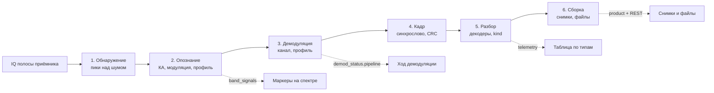

# ADR-009: Опознание сигнала и разбор полезной нагрузки

**Дата:** 2026-10-22
**Статус:** Accepted
**Ревизия 2026-11-07:** §5.4 происхождение (КА или земной) и ритм, §5.5 статистика по времени, §6.1 распознавание модуляции и службы по структуре сигнала. Обнаружитель (DEMOD-017) и распознавание (DEMOD-015) идут первыми (§12).
**Связанные задачи:** DEMOD-005, DEMOD-007, DEMOD-008, DEMOD-009…015, DEMOD-017, TX-DB-001, SIGLAB-001
**Связанные ADR:**
- ADR-004 (Режимы) — §3.6 детектор пакетов, §3.7 колонка «Результат», §8 источники передатчиков. Здесь они получают общий конвейер.
- ADR-005 (Референсы) — §2.3: раскладки форматов пишем своими таблицами на Go, без Kaitai.
- ADR-007 (Анализ) — стадия 3 «Характеризация» использует ту же оценку признаков сигнала (§6 здесь); Анализ остаётся местом для незнакомых форматов.
- ADR-002 / ADR-003 (Транспорт) — события конвейера идут по SSE (JSON), содержимое снимков и файлов отдаётся по REST.

---

## 1. Контекст и проблема

### 1.1. Что видно на реальной записи

Replay записи GEOSCAN-EDELVEIS (pe0sat, 2022-11-24, 322 с) через профиль `fsk9600_geoscan`:

- канальный уровень работает: 181 кадр с верной CRC за 320 с;
- почти все кадры — куски JPEG-снимка, маяков единицы;
- в таблице ТМИ появляется одна строка «кому: T» с hex `…01 7D 01 02 03 00 04 11 05 12 21 31 41…`. Это стандартная таблица Хаффмана JPEG, кусок снимка. `ax25.Parse` принял случайные байты за UI-кадр;
- остальные кадры снимка никуда не выводятся.

Демодулятор есть, кадры есть, а оператор не получает ни снимка, ни понимания, что принимается. Вдобавок ему показывают ложный кадр.

### 1.2. Корневые причины

1. **Разбор жёстко привязан к AX.25.** `demod.Chain` после выделения кадра сразу вызывает `ax25.Parse`; поля маяка GEOSCAN разбираются частным `if demod == demodGEOSCAN`. Другие типы данных (снимки, GNSS, файлы) и другие КА в эту схему не вписываются.
2. **Нет понятия «тип полезной нагрузки».** Событие `telemetry` — это адреса AX.25, текст и hex. Снимок, маяк и мусор выглядят одинаково.
3. **Нет проверки правдоподобия.** Разбор считается успешным, если байты синтаксически похожи на заголовок AX.25.
4. **Нет связи «сигнал в полосе ↔ КА ↔ демодулятор».** Оператор сам угадывает профиль; на спектре нет подсказок, где сигнал и что это.
5. **Индикация демодулятора скудная.** Видны только уровень и счётчики CRC; непонятно, на каком этапе цепочка теряет сигнал.

### 1.3. Требование оператора

- В полосе приёмника (до ~2,4 МГц) отмечать сигналы: тип сигнала и какой демодулятор выбрать; если неизвестно — так и писать.
- После демодуляции показывать **всё** человекочитаемо: снимки, значения ТМИ, сообщения. Hex — только если разобрать не удалось.
- Показывать тип полезной нагрузки.
- Показывать ход работы демодулятора.
- Решение должно масштабироваться на все демодуляторы и КА, а не только на GEOSCAN.

---

## 2. Принятые решения (обзор)

| # | Решение |
|---|---------|
| 2.1 | **Единый конвейер из шести этапов:** обнаружение, опознание, демодуляция, кадр, разбор, сборка (§3). Каждый этап — свой пакет со своим контрактом. |
| 2.2 | **Демодулятор выдаёт сырой кадр**, а не `ax25.Frame`. Разбор AX.25 становится одним из декодеров слоя разбора. |
| 2.3 | **Реестр декодеров полезной нагрузки** с явным порядком: декодеры опознанного КА, потом декодеры канального формата, потом общие, потом «Неизвестно» (§7). |
| 2.4 | **Декодер обязан подтвердить формат по структуре.** Синтаксически похожий заголовок — не подтверждение (§7.3). |
| 2.5 | **Конверт полезной нагрузки с полем `kind`** (маяк, сообщение, снимок, файл, навигация, неизвестно). UI рисует по `kind`, hex — только у `unknown` и в модалке (§7.2). |
| 2.6 | **Сборщики продуктов** собирают многокадровые данные (снимки, файлы) на бэкенде, хранят в `data/products/` и отдают по REST (§8). |
| 2.7 | **Каталог форматов:** карточка КА «NORAD, передатчик, профиль, декодеры» — данные, а не код. Встроенный JSON плюс оверрайды пользователя (§4). |
| 2.8 | **Сигналы в полосе** — объединение ожидаемых (каталог + SatNOGS + Доплер) и обнаруженных (детектор над шумом). SSE `band_signals`, маркеры на Спектре и Панораме (§5). |
| 2.9 | **Демодулятор «Авто»:** пробный приём кандидатами параллельно на одном канале, побеждает профиль с верной CRC (§6.2). Ручной выбор всегда главнее. |
| 2.10 | **Индикация конвейера** (§9): строка из шести этапов с порогами на сервере, диагноз по первому не зелёному этапу, лента синхрослов за 60 с, живые гистограмма и глаз (`demod_scope`), цвет канала на спектре; немеряемые метрики убираются из панели. |
| 2.11 | **Регрессия на реальных записях:** манифест ожидаемых результатов по `data/recordings/`; тест пропускается, если файла нет (§10.2). |
| 2.12 | **Что за сигнал — по структуре** (§6.1): модуляция, параметры и служба по сигнатуре, деревом признаков без нейросети. **КА или земной — по Доплеру** и окну пролёта (§5.4), ритм (НПД, периодический, эпизодический) — по статистике времени (§5.5). |

---

## 3. Конвейер



| Этап | Вход | Выход | Пакет | Сейчас |
|------|------|-------|-------|--------|
| 1. Обнаружение | БПФ полосы | список занятых участков (центр, ширина, SNR, время) | `internal/signals` | нет |
| 2. Опознание | участки + каталог + SatNOGS + `range_rate` | КА (или «Неизвестно»), модуляция, кандидаты профилей | `internal/signals`, `internal/formats` | нет |
| 3. Демодуляция | IQ канала + профиль | уровни линии | `internal/demod`, `internal/modem` | есть |
| 4. Кадр | уровни линии | сырой кадр с верной CRC, счётчики синхрослов | `internal/ax25`, `internal/geoscan`, … | есть, но сразу парсит AX.25 |
| 5. Разбор | сырой кадр + контекст | конверт полезной нагрузки | `internal/payload` + декодеры у своих форматов | частично (маяк GEOSCAN) |
| 6. Сборка | куски продуктов | снимок или файл с прогрессом | `internal/products` | нет |

Этапы 1–2 работают на всю полосу и не зависят от выбранного канала. Этапы 3–6 работают на канал демодулятора (DEMOD-008). Этапы 5–6 работают и без 1–2: replay записи КА, которого нет в зоне видимости, всё равно разбирается по канальному формату.

---

## 4. Каталог форматов

### 4.1. Что где живёт

| Сущность | Где | Почему |
|----------|-----|--------|
| **Профиль демодулятора** (модуляция, скорость, линейный код, выделитель кадров) | Go-реестр в `internal/demod` рядом с реализацией: `id`, подпись, семейство модуляции, скорость, полоса по умолчанию, соответствие режимам SatNOGS | Профиль — это код; метаданные не должны расходиться с реализацией |
| **Декодер полезной нагрузки** | Go-код у своего формата (`internal/geoscan`, `internal/ax25`, …), регистрация по `id` | Раскладка полей — таблица на Go (ADR-005 §2.3) |
| **Карточка КА** (NORAD, передатчики, профиль, декодеры) | `internal/formats/catalog.json` (встроен через `go:embed`), оверрайды в `data/formats.json`, позже — локальная БД `TX-DB-001` | Добавить КА на известном профиле — правка данных без кода |

Это тот же подход, что `satyaml` у gr-satellites: описание КА — данные, блоки обработки — код.

### 4.2. Карточка КА

```json
{
  "norad": 53385,
  "name": "GEOSCAN-EDELVEIS",
  "transmitters": [
    {
      "freq_hz": 436200000,
      "profile": "fsk9600_geoscan",
      "bandwidth_hz": 20000,
      "decoders": ["geoscan.beacon", "geoscan.image"],
      "callsigns": ["RS20S"]
    }
  ]
}
```

### 4.3. Связь с SatNOGS

SatNOGS даёт частоту, режим (`FSK`, `AFSK`, `GMSK`, `BPSK`…) и скорость, но не канальный формат: «FSK 9600» — это и G3RUH AX.25, и GEOSCAN CC11xx, и AX.100. Поэтому:

- карточка каталога **закрепляет** профиль точно;
- без карточки режим и скорость SatNOGS дают **список кандидатов** (профили с совпадающими семейством и скоростью), дальше работает «Авто» (§6.2);
- поле декодера в SatNOGS DB (имена `satnogs-decoders`, например `geoscan`) — подсказка для выбора декодеров, по таблице соответствия имён.

---

## 5. Сигналы в полосе

### 5.1. Источники маркеров

| Источник | Что даёт | Когда |
|----------|----------|-------|
| **Ожидаемые** | передатчики КА над горизонтом (каталог и SatNOGS), частота с поправкой на Доплер: `f = f0·(1 − range_rate / c)` | всегда, даже без энергии в эфире |
| **Обнаруженные** | участки с энергией выше шума: центр, ширина, SNR, время последнего появления | когда есть сигнал |
| **Подтверждённые** | на канале демодулятора есть кадры с верной CRC | после приёма |

Обнаруженный участок сопоставляется с ожидаемым по частоте в пределах допуска на Доплер и ошибку опорника. Это то, что ADR-004 §3.6 называет «attribution к передатчику».

### 5.2. Подпись маркера

Формат: `<КА> · <модуляция> · <демодулятор>`.

| Состояние | Пример подписи | Вид |
|-----------|----------------|-----|
| Ожидается, энергии нет | `GEOSCAN-EDELVEIS · FSK 9k6 · FSK 9600 (GEOSCAN)` | пунктир, приглушённо |
| Есть сигнал, КА опознан | то же | сплошная заливка полосы |
| Есть сигнал, КА не опознан, признаки оценены | `Неизвестно · FSK ≈9600 бод · кандидаты: G3RUH, GEOSCAN` | заливка, знак вопроса |
| Есть сигнал, признаков нет | `Неизвестно · ≈18 кГц` | заливка, знак вопроса |
| Демодулятор есть, но не реализован | `… · нет демодулятора` | заливка, предупреждение |
| Кадры принимаются | `… · ✓ 181 кадр` | акцент |

Щелчок по маркеру ставит центр и ширину канала (DEMOD-008) и профиль; у неизвестного — профиль «Авто». Цвета — токены темы (`ui-color-theme.mdc`).

**Где рисуется (решение 2026-11-07).** Маркеры разнесены по смыслу, чтобы не засорять график БПФ:

- **БПФ** — только риски ожидаемых передатчиков (`tx_markers`): где КА должен звучать сейчас, даже без энергии.
- **Водопад, полоса у верхнего края** — обнаруженные сигналы: треугольник на частоте и короткий код («КА», «OOK», «DMR», «ЧМ»), остальное (§6.1, §5.4–5.5) — в подсказке, щелчок ставит канал. Картинку водопада полоса не закрывает. Сигнал, подтверждённый как КА, красится цветом КА, как его риска на БПФ.
- **Водопад, метки в истории** — второй шаг, выключаются переключателем. Метка ставится в строку водопада, где сигнал впервые появился или сменил распознанный тип (не на каждую пачку), и уезжает вниз вместе со строкой; строка — по времени события и шагу водопада.
- Общая кнопка «скрыть маркеры» убирает полосу и метки, когда нужен чистый водопад.

### 5.3. Детектор

- Отдельный потребитель потока тракта (как `demod.Service`): своё БПФ 4096 точек, не зависит от БПФ клиентов `/spectrum`. Решение выносится 4–8 раз в секунду.
- БПФ считается по всем блокам интервала, не по одному: шум берётся из среднего за интервал, а обнаружение — из максимума. Иначе вспышку короче интервала (брелок, кадр 9600 бод) детектор пропустит.
- Работает только годная часть полосы (`Capabilities.UsableFraction`); бин постоянной составляющей в центре не считается сигналом.
- Уровень шума по бину — скользящая медиана во времени; участок — соседние бины выше шума на порог (по умолчанию 6 дБ), слитые с перекрытием.
- Пакетные сигналы (маяки, кадры) живут короткими вспышками, поэтому участок держится заданное время после последнего появления (по умолчанию 10 с) и появляется не после первого БПФ, а по гистерезису.
- Результат — SSE `band_signals` раз в секунду на тракт (§11.2). Событие `unknown_carrier` из ADR-004 §8.1 заменяется этим событием: неизвестная несущая — это участок без опознания.
- Поток устройства идёт, пока открыт спектр, поэтому детектор и статистика §5.5 работают только в это время.

### 5.4. Происхождение и ритм

Маркер отвечает на три вопроса: что это по структуре (модуляция и служба, §6.1), КА это или земной сигнал (`origin`) и как он работает во времени (`rhythm`). Здесь — два последних.

Вопрос «это КА или нет» по форме сигнала не решается: маяк 9600 бод раз в 10 с и датчик в ЛПД 433 МГц оба дают 2FSK пачками. Решают признаки, которых у земных сигналов нет:

- **Доплер.** На 437 МГц уход до ±10 кГц, на 145 МГц до ±3,4 кГц, в середине пролёта 150–200 Гц/с. Земная станция стоит на частоте. Уход кварца приёмника (около 1 ppm, сотни герц) медленный и одинаков для всех сигналов полосы.
- **Окно пролёта.** Сигнал КА есть только между AOS и LOS.
- **Совпадение с расчётом.** Ожидаемый передатчик (риска `tx_markers`, частота с Доплером) указывает, где КА звучит сейчас.

| `origin` | Подпись | Условие |
|----------|---------|---------|
| `satellite` | КА | участок совпал с ожидаемым передатчиком в допуске и следует за ним: за время наблюдения расчётная частота ушла хотя бы на 2 бина, а участок остался в допуске. Подтверждён, если на канале идут кадры (`confirmed`) |
| `satellite_probable` | КА? | совпал с ожидаемым передатчиком, но расчётная частота ещё не ушла на 2 бина (начало наблюдения, КА у горизонта) |
| `terrestrial` | Земной | частота стоит дольше 60 с наблюдения (уход меньше 1 бина), ожидаемого передатчика рядом нет или он ушёл, а участок остался |
| `unknown` | — | наблюдается меньше 60 с, совпадения нет |

| `rhythm` | Подпись | Условие |
|----------|---------|---------|
| `steady` | НПД | в эфире ≥ 90 % времени наблюдения, наблюдение ≥ 5 мин |
| `periodic` | Период. N с | вспышки, разброс интервалов между началами ≤ 20 % медианы, не меньше 4 интервалов |
| `intermittent` | Эпизод. | вспышки без устойчивого периода (голосовые станции, брелоки) |
| `new` | — | наблюдается меньше 60 с; на маркере время наблюдения |

Допуск совпадения: половина ширины участка, плюс 1 бин, плюс поправка кварца (`freq_correction_ppm` не обнуляет ошибку, берётся 2 ppm частоты). Земной сигнал на частоте КА отсеивается сам: риска уходит по Доплеру, участок остаётся на месте.

**Подсказка по частотному плану** (`hint`) — не вывод детектора, а место в плане; сигнатуры служб (§6.1.4) используют её как один из признаков: «ЛПД 433» (433,075–434,790 МГц), «PMR 446» (446,0–446,2), «Люб. 2 м» (144–146), «Люб. 70 см» (430–440), «Метео» (137–138), «Вещ. ЧМ» (87,5–108). Ширина добавляет признак: 8–16 кГц — узкая ЧМ, от 150 кГц — широкая. Таблица встроена в код, оверрайды — вместе с каталогом форматов (§4).

Помехи приёмника (паразитные пики RTL-SDR, гармоники кварца и компьютера) — следующий шаг: их выдаёт то, что при перестройке они остаются на том же смещении от центра. Для этого нужна история между перестройками (§5.5).

### 5.5. Статистика по времени

У каждого участка ведётся:

- время первого и последнего появления;
- время наблюдения — сколько его частота была в годной части полосы при идущем потоке. Доля времени в эфире считается от него, а не от часов: пока спектр закрыт или приёмник стоит на другой частоте, сигнал не «молчит», а не наблюдается;
- время в эфире и число вспышек (начало — выход выше порога, конец — уход ниже с гистерезисом 2 дБ);
- интервалы между началами вспышек (последние 16) для периода;
- уход центра за время наблюдения, Гц/с.

**Охват (решение 2026-11-07).** Сейчас статистика собирается на «Спектре» — по частоте и полосе, на которые настроен приёмник. Участок опознаётся по абсолютной частоте и хранится в памяти сервера до его перезапуска: после перестройки или смены полосы ушедшие за край участки не удаляются, а перестают наблюдаться; при возврате статистика на месте и продолжается. Память ограничена: не больше 2000 участков на тракт, при переполнении уходят давно не появлявшиеся.

**Панорама — следующий шаг**, вместе с `DWELL-001`. Логика та же: время наблюдения участка копится только пока обход стоит на его полосе, поэтому доля в эфире и период остаются честными. Ритм с периодом длиннее цикла обхода по панораме не определяется — только на «Спектре».

Журнал эфира станции — второй шаг: файл `data/band_log.json` (сохранение раз в минуту и при остановке, записи без появления дольше 30 дней удаляются): через неделю это карта местных помех, и НПД известен с первой секунды.

---

## 6. Опознание и выбор демодулятора

### 6.1. Распознавание по структуре

**Ревизия 2026-11-07.** Было: узкая слепая оценка (FSK, AFSK, скорость, CW, BPSK «позже») последним этапом. Стало: распознавание модуляции по структуре IQ на все участки, параметры и сигнатуры служб, сразу за детектором (этап 0б, §12). Оператор должен видеть, что это за сигнал, а не только КА это или нет.

Ответ на маркере в три уровня:

1. **Модуляция** с уверенностью: «OOK», «4FSK», «ЧМ аналог.».
2. **Параметры**: занятая полоса, скорость, девиация, сдвиг тонов, длительность пачки.
3. **Служба**, если совпала сигнатура (§6.1.4): «Датчик ЛПД», «DMR», «Вещание ЧМ: <название из RDS>». Не совпала — маркер остаётся на уровне 2, служба не угадывается.

Нейросеть не используется (§13): дерево признаков объяснимо (в подсказке маркера видно, почему «OOK»), не требует обучающего набора и проверяется имитатором.

#### 6.1.1. Вырезка участка

Детектор (§5.3) отдаёт классификатору кусок IQ участка: перенос на ноль (`dsp` xlating), прореживание до ~2,5 ширины участка (не меньше 25 кГц, у широкой ЧМ — 250 кГц), длительность 0,5 с у непрерывных, у пачечных — от начала вспышки до конца, но не больше 2 с. Кольцевой буфер IQ тракта держит последние 2 с, поэтому начало пачки не теряется, пока детектор её подтверждает. Это около 40 МБ на тракт при 2,56 МС/с (complex64); на слабом железе — меньше секунд или ниже частота дискретизации (§14).

Очередь: новый участок — сразу, известный — раз в 10 с по кругу, один разбор за раз на тракт. Ответ сглаживается по последним 3 разборам: одна ошибка не перекрашивает маркер.

#### 6.1.2. Признаки

| Группа | Признак | Чем меряется |
|--------|---------|--------------|
| Огибающая | разброс нормированной амплитуды; два состояния «есть/нет» | σ `|x|/mean|x|`; гистограмма `|x|` с двумя горбами и долей у нуля |
| Мгновенная частота | число горбов (2 или 4), расстояние между ними (девиация) | гистограмма `arg(x[n]·conj(x[n−1]))` |
| | плавность (аналог против цифры) | доля времени между горбами; спектр выхода детектора |
| | линейный наклон пилой (ЛЧМ) | регрессия мгновенной частоты по отрезкам; подтверждение свёрткой с опорной ЛЧМ (пик после БПФ) |
| Фаза | BPSK, QPSK | линия в спектре `x²` (BPSK) или `x⁴` (QPSK) при отсутствии линии в `x` |
| Спектр | несущая, симметрия боковых | линия в центре (AM, CW, несущая); у SSB линии нет, спектр с одной стороны |
| Выход ЧМ-детектора | речь, подтон, пилот | доля энергии в 0,3–3 кГц; CTCSS 67–254 Гц по ряду; пилот 19 кГц и RDS 57 кГц у широкой ЧМ |
| | AFSK | тоны 1200/2200 Гц (Bell 202) и 1300/2100 Гц |
| Такты | символьная скорость | спектральная линия квадрата производной выхода детектора (FSK) или `|x|²` (OOK, PSK); сверка с рядом 300…19200, 4800 у DMR |
| Время | длительность пачки, период | статистика детектора (§5.5) |

#### 6.1.3. Дерево решений

1. **SNR участка < 10 дБ** — «не определено · ≈N кГц». Распознавание на шуме даёт уверенные ошибки, поэтому лучше честное «не знаю».
2. **Огибающая с двумя состояниями** (доля у нуля ≥ 20 %): узко (< 500 Гц) и ритм Морзе — CW; иначе OOK/ASK со скоростью по тактам.
3. **Огибающая постоянная** (σ < 0,15):
   - мгновенная частота стоит, линии в `x` нет, есть линия в `x²` — BPSK; в `x⁴` — QPSK;
   - мгновенная частота стоит, линия в `x` — немодулированная несущая;
   - пила — ЛЧМ, с наклоном и периодом;
   - 2 или 4 горба — 2FSK или 4FSK с девиацией и скоростью; GFSK и GMSK — та же ветка с пометкой «гладкие переходы» (точно не различаются);
   - плавная частота: широкая (≥ 150 кГц) — вещательная ЧМ (пилот, RDS), узкая — аналоговая ЧМ; если в выходе детектора тоны AFSK — AFSK со скоростью, если речь — «ЧМ голос», подтон CTCSS — частотой.
4. **Огибающая меняется без двух состояний**: несущая и симметричные боковые — AM; несущей нет и спектр односторонний — USB или LSB; иначе «линейная цифровая (PSK/QAM с фильтром)» без уточнения порядка.
5. Ничего не подошло — «Неизвестно · ≈N кГц» с измеренными признаками в подсказке.

Пороги (10 дБ, 20 %, 0,15, 150 кГц) — начальные, уточняются по таблице ошибок (§6.1.5).

#### 6.1.4. Сигнатуры служб

Сигнатура — данные, а не код, как карточка КА (§4): `internal/signals/signatures.json` (`go:embed`) и оверрайды `data/signatures.json`. Поля: модуляция, диапазоны скорости, девиации и ширины, ритм (длительность пачки, период, слоты), участок частотного плана, необязательный распознаватель синхрослова (Go-код по `id`).

| Служба | Сигнатура (кратко) |
|--------|--------------------|
| Датчик или брелок ЛПД | ЛПД 433, OOK или 2FSK, 1–10 кбод, пачки 0,05–1 с с повторами |
| Голосовая станция (PMR 446, ЛПД, проф.) | ЧМ аналог., речь, ширина 8–16 кГц, эпизодический ритм; канал PMR по частоте |
| DMR | 4FSK 4800 бод, 12,5 кГц, слоты 30 мс; синхрослово DMR |
| POCSAG | 2FSK 512/1200/2400 бод, девиация ±4,5 кГц; синхрослово POCSAG |
| APRS / пакет AX.25 | AFSK 1200 на 144,800 (и любой AFSK 1200 с кадром AX.25 — по декодеру §7) |
| LoRa | ЛЧМ 125/250/500 кГц, ЛПД 433 или 868 |
| Вещание ЧМ | широкая ЧМ 87,5–108, пилот 19 кГц; название станции из RDS (PS) |
| КА | `origin = satellite` и профиль из каталога (§4); ветка §6.2 |

Распознаватели синхрослов определяют только тип службы. Содержимое земных служб (переговоры, пейджинг, датчики) не разбирается и не показывается; исключение — открытые публичные поля вроде названия станции в RDS. Содержимое разбирается только у КА и любительских пакетов (§7).

Справочники форматов: описания стандартов (ETSI TS 102 361 для DMR, ITU-R M.584 для POCSAG, IEC 62106 для RDS); rtl_433 — как справочник по датчикам ЛПД, по правилам ADR-005 §2.2 (лицензию сверить при переносе).

#### 6.1.5. Проверка

- **Имитатор.** Генератор на каждую модуляцию в `internal/modem` и `internal/sdr/imitator`: уже есть FSK, AFSK, ЧМ звук, SSB, SSTV; добавить OOK, CW, AM, BPSK, QPSK, ЛЧМ, 4FSK, широкую ЧМ с пилотом и RDS, ЧМ с CTCSS.
- **Таблица ошибок.** Go-тест прогоняет каждую модуляцию по сетке SNR 0–30 дБ и случайных параметров и строит таблицу «передано / распознано». Требования: от 15 дБ верно ≥ 95 %; ниже 10 дБ — «не определено», а не другая модуляция (доля уверенных ошибок ≤ 2 %).
- **Записи.** Манифест §10.2 расширяется ожидаемой модуляцией и службой для записей эфира (SigMF).

Тот же код использует режим «Анализ» на стадии 3 (ADR-007 §3), поэтому реализация одна. Для участка, опознанного как КА, распознанная модуляция и скорость дают кандидатов профилей для «Авто» (§6.2).

### 6.2. Демодулятор «Авто»

Профиль `auto` в настройках канала:

1. Кандидаты по приоритету: профиль из карточки опознанного КА; профили по режиму и скорости из SatNOGS; профили по слепой оценке; все реализованные профили.
2. Кандидаты работают **параллельно на одном узком канале**. Канал на 64 кГц стоит единицы процентов CPU, поэтому 3–5 цепочек дёшевы.
3. Побеждает профиль, давший **два** кадра с верной CRC за окно (по умолчанию 30 с). Одна случайная CRC16 на шуме проходит; две подряд у неверного профиля — практически нет.
4. Победитель закрепляется, остальные цепочки останавливаются. Пересмотр — при смене канала или если кадров нет дольше окна пересмотра.
5. В панели: `Авто: FSK 9600 (GEOSCAN) · подобран по CRC` или `Авто: подбор… (3 кандидата)`.

Ручной выбор профиля отключает «Авто» до явного возврата.

### 6.3. Привязка кадра к КА (DEMOD-007)

КА кадра определяется по первому сработавшему источнику: позывной из полезной нагрузки по карточке; частота канала и КА над горизонтом; метаданные записи при replay (расширение SigMF, ADR-007 §2.9); тракт replay в конфиге. Источник указывается в событии (`sat_source`), чтобы оператор видел, насколько привязке можно верить.

---

## 7. Разбор полезной нагрузки

### 7.1. Декодер

Набросок контракта (Go):

```go
// Frame — сырой кадр после проверки CRC и контекст приёма.
type Frame struct {
	Raw         []byte
	Profile     string
	NORAD       int // 0, если КА не опознан
	FrequencyHz uint64
	TimestampMs uint64
}

// Decoder подтверждает формат кадра и разбирает его; ok=false — формат не подтверждён.
type Decoder interface {
	ID() string
	Decode(f Frame) (p Payload, ok bool)
}
```

Каждый декодер регистрируется с привязкой к профилю (канальному формату), к КА или как общий.

### 7.2. Конверт полезной нагрузки

| `kind` | Подпись в UI | Содержимое | Как показывать |
|--------|--------------|------------|----------------|
| `beacon` | Маяк ТМИ | `params[]` (id, имя, значение, единица, ключевое) | ключевые поля в строке, все — в модалке |
| `text` | Сообщение | `text` | текст |
| `image` | Снимок | кусок: `product_id`, смещение, данные | строка с миниатюрой «Снимок 3: кусок 41 · 63 %», сам снимок — только на вкладке «Снимки» |
| `file` | Файл | кусок файла | прогресс сборки |
| `position` | Навигация | координаты, время | значения, позже точка на карте |
| `unknown` | Неизвестно | только `info_hex` (+ адреса, если формат кадра известен) | hex |

Общие поля: `decoder`, `summary` (одна строка для таблицы), `src`, `dest` (если формат их содержит), `info_hex` (всегда; для модалки и отладки).

### 7.3. Порядок и строгость

Декодеры перебираются по ярусам, первый подтвердивший формат выигрывает:

1. декодеры карточки опознанного КА;
2. декодеры канального формата профиля (для CC11xx: `geoscan.beacon`, `geoscan.image`, …);
3. общие: строгий AX.25 UI, печатный текст;
4. `unknown`.

Подтверждение по структуре обязательно:

- **AX.25:** позывные только из `A–Z`, `0–9` и пробела-заполнителя в конце; SSID в допустимом диапазоне; бит конца адреса только у последнего адреса; управляющий байт и PID из допустимых. Кадр «кому: T» из §1.1 эту проверку не проходит.
- **Форматы КА:** магические байты или заголовок, длина, диапазоны ключевых полей.
- Синтаксически похожий заголовок без подтверждения уходит в `unknown`, а не в таблицу как ТМИ.

### 7.4. Пример: GEOSCAN-EDELVEIS

Наблюдения по записи pe0sat 2022-11-24 (64 байта данных в кадре CC1125):

- **Снимок:** заголовок 8 байт `01 00 3E TT 09 OO OO 0B` и 56 байт JPEG. `TT`: `01` — первый кусок, `05` — продолжение. `OO OO` — смещение little-endian, начинается с `0x8000`, шаг 56. Первый кусок начинается с `FF D8 FF DB`.
- **Маяк:** в записи встречен кадр с другим заголовком (`01 00 26 04 20`), за ним адреса AX.25 `BEACON` и `RS20S`. Значит, заголовок транспортного уровня стоит перед AX.25 и у маяка; декодер маяка должен учитывать оба варианта.
- Смысл третьего байта (`3E`, `26`), номер снимка и признак конца — не установлены, нужно больше кадров или описание Геоскана (§14).

---

## 8. Сборка продуктов

- Кусок из `Payload` (`product key`, смещение, данные, признаки начала и конца) передаётся сборщику по виду продукта. Ключ продукта включает NORAD (или тракт, если КА не опознан) и номер снимка или время начала.
- Сборщик снимка ведёт карту покрытия по смещениям: принято байт, пропуски, завершён ли. Пропуски заполняются нулями: браузер рисует JPEG до первого битого места, поэтому снимок проявляется по мере приёма.
- Хранение: `data/products/<дата>/<norad или тракт>/<id>.jpg` + `<id>.json` (карта покрытия, время, источник). Имена — по правилам `REC-PATHGUARD-001`.
- Продукт закрывается при признаке конца или по тайм-ауту без новых кусков (по умолчанию 2 мин).
- Логику держит Go; JS только показывает (ADR-007 §2.4).

---

## 9. Индикация работы демодулятора

Мокап страницы «Сеанс», вкладка «Спектр»: [`docs/img/tracking-page-demod-indication-mockup.jpg`](../img/tracking-page-demod-indication-mockup.jpg). Ход приёма и диагноз — в колонке приёмника вместо сетки из 16 метрик; лента «Кадры · 60 с» — под водопадом; маркеры сигналов и заливка канала — на БПФ и водопаде; таблица ТМИ на всю ширину, снимок — только на вкладке «Снимки» (в строке таблицы — миниатюра и процент приёма, решение 2026-10-22); гистограмма и глаз — во вкладке «Диаграмма». Неточности мокапа: миниатюра нарисована во всех строках, а нужна только у строк «Снимок»; маркеры «ожидается» и «Неизвестно» на БПФ (§5.2) не показаны; метки ленты должны собираться в пачки над вспышками уровня. Крупный план элементов панели: [`docs/img/demod-panel-indication-mockup.jpg`](../img/demod-panel-indication-mockup.jpg).

### 9.1. Что сейчас

В панели «Демодулятор» 16 метрик, живьём приходят четыре: уровень (RSSI), порог, «Кадров» (верные CRC), «Посл.». «Sync» считается как сумма верных и неверных CRC, то есть это не срабатывания синхрослова. Lock загорается, как только поток идёт. SNR, Es/N0, C/N0, BER, AFC, Δf, FEC — «—». Диаграмма глаза и созвездие — mock. Оператор видит, что кадров нет, но не видит почему.

### 9.2. Пять элементов индикации

**1. Строка этапов.** Шесть индикаторов слева направо, в шапке панели:

```text
 ● Сигнал   ● Несущая   ● Такты   ● Синхро   ● Кадры   ○ Разбор
 +14 дБ     −1,8 кГц    захват    12/10 с    181/37    снимок
```

| Этап | Чем измеряется | Зелёный | Жёлтый | Красный / серый |
|------|----------------|---------|--------|-----------------|
| Сигнал | уровень в канале и SNR против шума рядом с каналом (DEMOD-005) | SNR ≥ 10 дБ | 3–10 дБ | ниже 3 дБ или порог закрыт |
| Несущая | середина между уровнями частотного детектора (`(high + low) / 2` у `FSKDemod`, сдвиг тонов у AFSK), в Гц от центра канала | уход < 10 % полосы | 10–30 % | > 30 %: сигнал у края канала |
| Такты | разброс ошибки тактовой ФАПЧ за последние N символов | стабильный захват | захват рвётся | захвата нет |
| Синхро | срабатывания синхрослова (CC11xx) или флага HDLC (AX.25) за 10 с; число ошибочных бит в синхрослове | есть, ошибок 0–1 | есть, ошибок 2–4 | нет |
| Кадры | CRC верна / неверна за 10 с и с начала сеанса | есть верные | только неверные | нет попыток |
| Разбор | последний `kind` и декодер; доля `unknown` | всё разобрано | есть `unknown` | только `unknown` |

Состояния считает сервер по порогам; фронт только красит. Пока индикатор не измеряется для профиля (например, такты у будущего BPSK), он серый с подписью «не измеряется», а не «—».

**2. Диагноз одной строкой.** Под строкой этапов — текст по **первому** не зелёному этапу:

| Первый не зелёный | Текст |
|-------------------|-------|
| Сигнал | «Сигнала в канале нет: проверь частоту и порог» |
| Несущая | «Сигнал смещён на −7,2 кГц от центра канала: сдвинь канал или включи Доплер» |
| Такты | «Сигнал есть, такты не захватываются: вероятно, другая скорость или модуляция» |
| Синхро | «Такты есть, синхрослово не находится: вероятно, другой формат кадра. Попробуй «Авто»» |
| Кадры (только неверные) | «Синхрослово находится, CRC не сходится: слабый сигнал или узкая полоса канала» |
| Разбор (только `unknown`) | «Кадры принимаются, формат данных не известен: нет декодера для этого КА» |
| всё зелёное | «Приём идёт: 181 кадр, последний 2 с назад (снимок)» |

**3. Лента событий за 60 с.** Полоса по времени под строкой этапов. Фон — уровень сигнала и открытый порог, поверх — метки на каждое найденное синхрослово:

```text
 уровень ▁▁▂▆██▇█▇██▆▂▁▁▁▁▂▇██▇▁▁
 кадры        ●●●×●● ●●●     ●●○●
             −60 с                    сейчас
```

`●` — CRC верна и разобрано, `○` — CRC верна, формат не известен, `×` — CRC не сошлась. Видно, что демодулятор работает, даже когда разбирать нечего: маяк пришёл, пачка кадров снимка пошла, сигнал пропал. Метки по щелчку открывают кадр в модалке.

**4. Живые диаграммы вместо mock.** На вкладке «Диаграмма»:

- **Гистограмма выхода частотного детектора** (64 корзины): два горба у 2-FSK, четыре у 4-FSK, расстояние между горбами — девиация, середина — уход несущей. Сразу видно, совпадает ли модуляция с профилем.
- **Глаз:** выход детектора, нарезанный по найденным тактам, 2 символа на след, до 64 следов. Открытый глаз — профиль и полоса верны, закрытый — нет.
- Созвездие — только у профилей PSK, когда они появятся.

Данные готовит сервер (§11.5), браузер только рисует.

**5. Состояние на спектре.** Заливка канала (DEMOD-008) окрашивается по последнему достигнутому этапу: серая — сигнала нет, синяя — сигнал есть, кадров нет, зелёная — кадры принимаются. Индикация видна, даже если панель демодулятора закрыта.

### 9.3. Что убрать из панели

Es/N0, C/N0, FEC — убрать до профилей с FEC (USP), чтобы не держать «—». BER заменить честной оценкой по ошибкам в синхрослове: число ошибочных бит в найденных синхрословах на число их бит. Это реальная оценка BER канала, а не BER после FEC. «Sync» показывать как срабатывания синхрослова, а не как сумму CRC. Lock заменяется индикатором «Такты».

### 9.4. При «Авто»

Пока идёт подбор (§6.2), строка этапов показывает лучшего кандидата, а под ней — список: «G3RUH: синхро нет · GEOSCAN: 3 кадра · AFSK: сигнала нет».

---

## 10. Масштабирование

### 10.1. Что делать, чтобы добавить…

| Что | Шаги |
|-----|------|
| **Модуляцию или линейный код** | профиль в реестре `internal/demod` (с метаданными §4.1), модем имитатора, тест приёма своего же сигнала |
| **Канальный формат** | выделитель кадров со счётчиками синхрослов и CRC, профиль, тест на синтетических кадрах |
| **КА на известном профиле и формате** | карточка в каталоге; кода нет |
| **КА со своим форматом данных** | декодер (таблица полей на Go, ADR-005 §2.3) с подтверждением по структуре, карточка, тест на синтетических кадрах и на записи |
| **Тип полезной нагрузки** | значение `kind`, отрисовка в UI, сборщик, если данные многокадровые |

Ни один шаг не требует правки `demod.Chain` или `demod.Service` под конкретный КА: частные ветки вида `if demod == demodGEOSCAN` уходят в реестры.

### 10.2. Регрессия на записях

`data/recordings/manifest.json`: запись, профиль, сдвиг канала, ожидаемые числа по `kind` (например, EDELVEIS: CRC верна ≥ 170, `image` ≥ 160, `unknown` = 0). Go-тест прогоняет каждую запись через конвейер быстрее реального времени и сверяет. Записи в git не входят, поэтому тест пропускается при отсутствии файла.

---

## 11. Контракты

### 11.1. SSE `telemetry` (расширение, старые поля сохраняются)

```json
{
  "radio_path": "path1",
  "timestamp_ms": 1669300000000,
  "frequency_hz": 436200000,
  "demod": "fsk9600_geoscan",
  "norad_id": 53385,
  "sat_name": "GEOSCAN-EDELVEIS",
  "sat_source": "replay",
  "decoder": "geoscan.image",
  "kind": "image",
  "summary": "Снимок 53385-1: кусок 41, смещение 2296",
  "product_id": "53385-20221124T1412-1",
  "src": "", "dest": "",
  "info": "",
  "params": [],
  "info_hex": "01003e0509..."
}
```

### 11.2. SSE `band_signals`

```json
{
  "radio_path": "path1",
  "timestamp_ms": 1669300000000,
  "noise_dbfs": -82.5,
  "signals": [
    {
      "id": "s7",
      "center_hz": 436198200, "bandwidth_hz": 18000, "snr_db": 14.2,
      "state": "active",
      "last_seen_ms": 1669299999000,
      "norad_id": 53385, "sat_name": "GEOSCAN-EDELVEIS",
      "modulation": "FSK 9600", "profile": "fsk9600_geoscan",
      "candidates": [], "frames_good": 181,
      "origin": "satellite", "rhythm": "periodic", "hint": "Люб. 70 см",
      "structure": {
        "modulation": "2fsk", "confidence": 0.93,
        "params": {"occupied_hz": 17500, "baud": 9600, "deviation_hz": 3200},
        "service": "satellite", "why": "огибающая постоянна, 2 горба частоты, такты 9600"
      },
      "stats": {
        "first_seen_ms": 1669299700000, "observed_s": 300, "on_s": 41,
        "bursts": 29, "period_s": 10.1, "drift_hz_s": -162
      }
    },
    {
      "id": "s9",
      "center_hz": 433920000, "bandwidth_hz": 40000, "snr_db": 22.0,
      "state": "active", "last_seen_ms": 1669299998000,
      "origin": "terrestrial", "rhythm": "intermittent", "hint": "ЛПД 433",
      "structure": {
        "modulation": "ook", "confidence": 0.97,
        "params": {"occupied_hz": 32000, "baud": 2000, "burst_ms": 420},
        "service": "ism_sensor", "service_label": "Датчик или брелок ЛПД",
        "why": "огибающая есть/нет, такты 2000, пачки 0,4 с с повторами"
      },
      "stats": {"first_seen_ms": 1669299000000, "observed_s": 1000, "on_s": 6, "bursts": 14}
    }
  ]
}
```

`state`: `expected` (ожидается, энергии нет), `active` (есть энергия), `confirmed` (кадры принимаются). Неопознанный участок — без `norad_id` и `profile`, с `candidates`.

`origin`, `rhythm` и `hint` — §5.4, `structure` — §6.1, `stats` — §5.5. `period_s` есть только у `periodic`. `structure` нет, пока участок не разобран; при SNR ниже порога — `modulation: "undetermined"`. `service` нет, если сигнатура не совпала. У `expected` нет `origin`, `rhythm`, `structure` и `stats`.

Значения `modulation`: `carrier`, `cw`, `ook`, `am`, `usb`, `lsb`, `fm_voice`, `fm_analog`, `wfm`, `afsk`, `2fsk`, `4fsk`, `bpsk`, `qpsk`, `linear_digital`, `lfm`, `unknown`, `undetermined`.

### 11.3. SSE `product` и REST

- SSE `product`: `product_id`, `kind`, `norad_id`, `received_bytes`, `chunks`, `gaps`, `complete`, `updated_ms`. Не чаще раза в секунду на продукт.
- `GET /api/products?limit=N` — список; `GET /api/products/{id}` — метаданные и карта покрытия; `GET /api/products/{id}/content` — содержимое (`image/jpeg` и т. п.).

### 11.4. `demod_status.pipeline`

```json
"pipeline": {
  "signal":  {"state": "ok",   "level_dbfs": -52.0, "snr_db": 14.2},
  "carrier": {"state": "ok",   "offset_hz": -1830, "deviation_hz": 2400},
  "symbols": {"state": "ok",   "baud": 9600, "lock": true, "timing_jitter": 0.04},
  "sync":    {"state": "ok",   "hits_10s": 12, "bit_errors_avg": 0.6, "ber_est": 0.019},
  "frames":  {"state": "ok",   "good_10s": 11, "bad_10s": 1, "good": 181, "bad": 37},
  "payload": {"state": "warn", "last_kind": "image", "decoder": "geoscan.image", "unknown": 2},
  "diagnosis": "Приём идёт: 181 кадр, последний 2 с назад (снимок)"
},
"events": [
  {"t_ms": 1669300000120, "sync_errors": 1, "crc": true, "kind": "image"},
  {"t_ms": 1669300000190, "sync_errors": 3, "crc": false}
]
```

`state`: `idle` (не измеряется или нет данных), `ok`, `warn`, `fail`. `events` — синхрослова с прошлого `demod_status` (раз в секунду), фронт держит из них ленту за 60 с.

### 11.5. SSE `demod_scope`

Снимок для диаграмм, 2 раза в секунду, только пока открыта вкладка «Диаграмма» (подписка по запросу фронта):

```json
{
  "radio_path": "path1",
  "hist": {"min": -1.0, "max": 1.0, "bins": [0, 1, 4, 18, "...64 значения"]},
  "eye": {"samples_per_symbol": 7, "traces": [[0.81, 0.77, "..."], "...до 64 следов"]}
}
```

Размер — 2–4 КБ. Это не поток IQ и не БПФ (ADR-002), а сводка, поэтому SSE допустим.

---

## 12. Этапность

| Этап | Задачи | Результат для оператора |
|------|--------|-------------------------|
| 0 | DEMOD-017 | треугольники обнаруженных сигналов в полосе у верхнего края водопада «Спектра»: КА или земной, ритм (НПД, периодический, эпизодический), подсказка по частотному плану, статистика времени работы в подсказке маркера |
| 0б | DEMOD-015 | на маркере — что за сигнал: модуляция и параметры по структуре (§6.1), служба по сигнатуре («Датчик ЛПД», «DMR», «Вещание ЧМ: …»); общий код с «Анализом» |
| 1 | DEMOD-010, DEMOD-012 | ложные кадры исчезли, колонка «Тип», маяк полями, куски снимка видны строками; ход демодуляции по этапам |
| 2 | DEMOD-011 | вкладка «Снимки»: снимок проявляется при приёме, сохраняется в `data/products/` |
| 3 | DEMOD-009, DEMOD-013, DEMOD-007 | маркеры ожидаемых передатчиков на спектре, кадры привязаны к КА, щелчок по маркеру ставит канал и профиль |
| 4 | DEMOD-014 | демодулятор «Авто» |

Этапы 0 и 0б не зависят от каталога и демодуляции: им нужны только поток тракта и ожидаемые передатчики, которые уже есть (`tx_markers`). Этап 1 не зависит от каталога: декодеры GEOSCAN привязываются к профилю `fsk9600_geoscan` (ярус 2 в §7.3).

---

## 13. Что отклонено

| Вариант | Почему нет |
|---------|-----------|
| Показывать в ТМИ всё, что разобрал `ax25.Parse` | текущее поведение; даёт ложные кадры (§1.1) |
| Профиль и декодер на каждый КА в коде `demod` | не масштабируется; частные ветки в общей цепочке |
| Собирать снимок на фронте из hex | логика в Go, JS рисует (ADR-007 §2.4); фронт не должен знать форматы КА |
| Классификация модуляции нейросетью | дерево признаков (§6.1) объяснимо оператору, не требует обучающего набора и проверяется имитатором; для выбора профиля КА пробный приём по CRC (§6.2) надёжнее. Пересмотреть, если дерево не даст требований §6.1.5 |
| Kaitai для форматов | ADR-005 §2.3 (лицензия `.ksy`, JVM на машине разработчика) |
| Параллельные демодуляторы на всю полосу сразу | это канализатор (`SDR-007`); здесь параллельно работают только кандидаты на одном узком канале |

---

## 14. Открытые вопросы

1. Семантика заголовка кадров GEOSCAN (третий байт, номер снимка, признак конца) — нужны ещё записи или описание Геоскана.
2. Каталог и локальная БД `TX-DB-001`: встроенный JSON — значения по умолчанию, оверрайды переезжают в БД, когда она появится. Подтвердить при старте `TX-DB-001`.
3. Ограничение объёма `data/products/` и срок хранения.
4. Бюджет CPU и памяти для «Авто», детектора и распознавания на слабом железе (Raspberry Pi): число кандидатов, частота БПФ детектора, длина буфера IQ (§6.1.1).
5. Показывать ли ожидаемые маркеры до AOS (КА ещё не над горизонтом, но в окне Плана сеансов).
6. Держать ли поток устройства ради статистики §5.5, когда спектр закрыт. Пороги классов §5.4 (90 %, 5 мин, 20 %) — начальные, уточняются на эфире.
