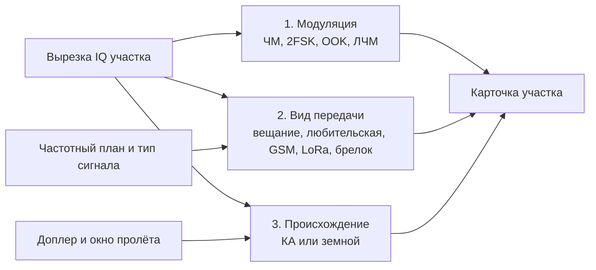
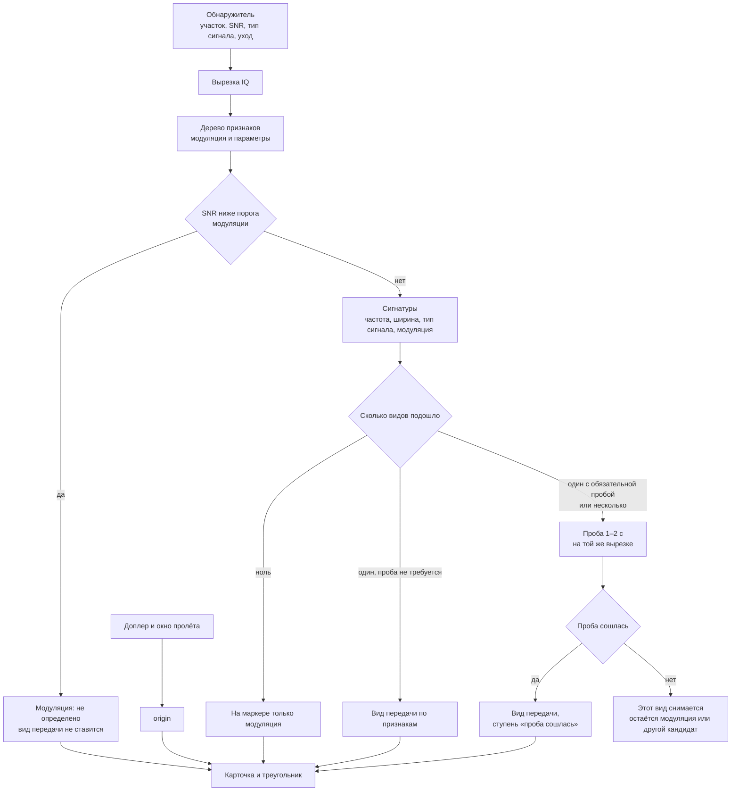
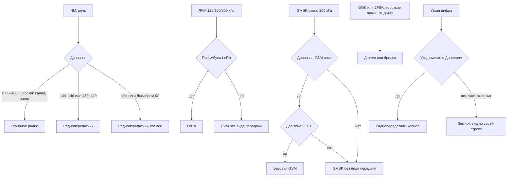
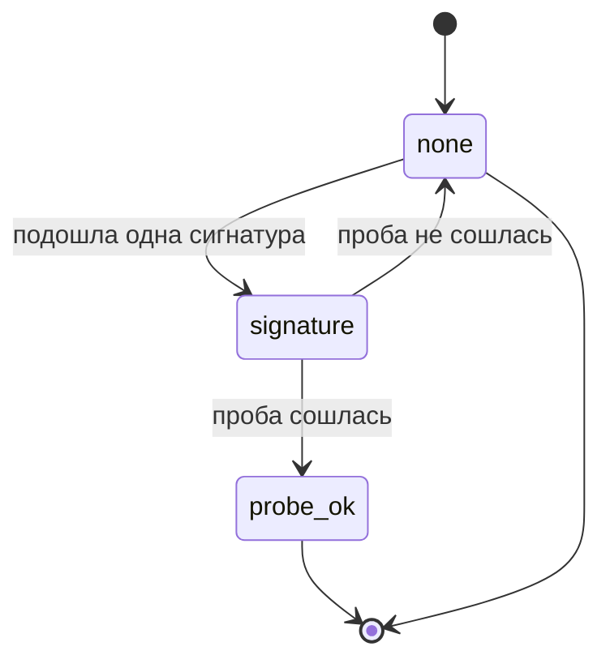
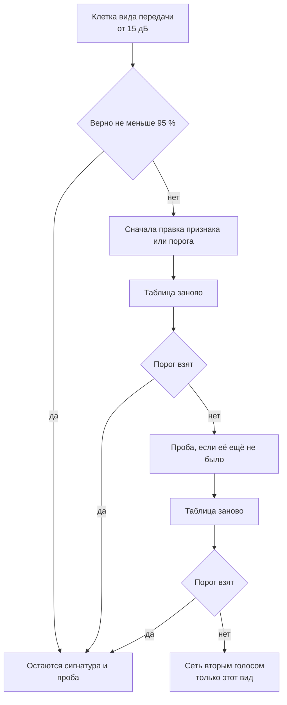

# ADR-010: Опознание вида передачи в эфире

**Дата:** 2026-11-09
**Статус:** Accepted
**Связанные задачи:** DEMOD-015 (части 3–4), DEMOD-017, SIGLAB-002, DEMOD-014
**Связанные ADR:**
- ADR-009 (Опознание и разбор) — этот документ уточняет §6.1.4 и §13. Дерево модуляции, Доплер и запрет разбирать содержимое земных передач остаются там.
- ADR-007 (Анализ) — та же оценка признаков на стадии 3, тот же код `internal/signalclass`.
- ADR-005 (Референсы) — rtl_433 берётся как справочник протоколов ЛПД, когда дойдёт очередь делить «датчик» и «брелок».

---

## 1. Контекст и проблема

### 1.1. Что нужно оператору

На каждом занятом участке эфира — подпись и достоверность. Ожидаемые подписи: вещание, любительская радиостанция, базовая станция GSM, LoRa, брелок или датчик, передатчик спутника. Последнее нужно и тогда, когда в каталоге нет карточки передатчика.

### 1.2. Это три вопроса, а не один класс

Одинаковая 2FSK пачками бывает и у маяка кубсата, и у брелока на 433 МГц. Одна модель с общим списком классов («радио / GSM / LoRa / спутник») смешивает три независимых ответа.

| Вопрос | Что отвечает | Примеры |
|--------|----------------|---------|
| Модуляция | как устроен сигнал | ЧМ, 2FSK, OOK, ЛЧМ |
| Вид передачи | что это за передача | вещание, любительская станция, GSM, LoRa, брелок |
| Происхождение | КА это или земной передатчик | КА, земной |
| Тип сигнала | как передача занимает эфир во времени | непрерывный, импульсный, импульсный периодический |

Вид передачи — это строка на карточке. В более раннем тексте ADR-009 то же самое называлось «службой». Дальше в этом документе только «вид передачи».

Тип сигнала — другая строка. «Постоянный» и «непрерывный» здесь одно значение. Секунды периода пишутся у третьего значения, «импульсный периодический, 10,1 с», и отдельным именем не называются. Пока наблюдение короче порога, тип не ставится. В JSON поле остаётся `emission`.



Процент достоверности считается отдельно на каждом вопросе.

### 1.3. Что уже есть

Обнаружитель (`internal/bandscan`) отдаёт участок: центр, ширина, SNR, тип сигнала, уход частоты. Дерево (`internal/signalclass`) по вырезке IQ ставит модуляцию и оценку уверенности. В эфире уже получены радиозонд 405 МГц как 2FSK около 4800 бод и вещательная ЧМ с пилотом 19 кГц и названием станции из RDS. SSTV ставится по тонам и заголовку VIS. Происхождение КА или земной считается по Доплеру и окну пролёта (ADR-009 §5.4).

Виды передачи из §1.1, кроме вещания и SSTV, в коде ещё не стоят. Это часть 3 `DEMOD-015`.

### 1.4. Два внешних проекта

[cnn-rtlsdr](https://github.com/art-injener/cnn-rtlsdr) — свёрточная сеть по сырым IQ. Готовая модель различает широкую ЧМ, несущую ТВ, DMR и «прочее». Процент на экране — softmax. Обучающие классы берутся из папок местной записи. Чекпоинт собран на TensorFlow 1, вход жёстко завязан на 2,4 МС/с. LoRa, брелока и спутника в модели нет.

[intercept](https://github.com/art-injener/intercept) — оболочка вокруг готовых декодеров (`rtl_433`, `multimon-ng`, dump1090). Вид известен, когда декодер собрал кадр. Отдельного распознавания модуляции нет. Детектор TSCM сравнивает частоту с базой и с таблицей «опасных» диапазонов.

Из первого проекта берётся приём: сеть может быть вторым голосом на сыром IQ. Из второго — приём: короткая проба декодером подтверждает вид передачи надёжнее, чем похожесть спектра. Ни код, ни чекпоинт, ни отдельный процесс, занимающий донгл, в тракт не переносятся. Поток IQ уже идёт через наш приёмник.

### 1.5. Что говорит ADR-009 §13

27 октября 2026 и в ревизии 7 ноября нейросеть отклонена как **первый** способ выбрать модуляцию и профиль КА. Причины на месте: дерево объясняется в подсказке, проверяется имитатором, для профиля КА два кадра с верной CRC надёжнее. Там же записано пересмотреть решение, если дерево не выполнит §6.1.5. Этот ADR задаёт, **когда** пересмотр наступает и чем сеть не занимается. Дерево первым классификатором модуляции остаётся.

### 1.6. Что ещё есть на GitHub

Обход 2026-11-09. Ни один репозиторий не подключается процессом и не занимает донгл. Берётся алгоритм, пишется на Go. У `rtl_433`, kalibrate и блоков GNU Radio лицензия GPL: текст этих программ в наш бинарник не копируется (ADR-005).

| Проект | Что в нём близко нам | Куда ложится |
|--------|----------------------|--------------|
| [haxorthematrix/riotduck](https://github.com/haxorthematrix/riotduck) | Появление над базой спектра, затем цепочка: `rtl_433`, демодулятор URH, разбор неизвестного (полоса, OOK/FSK/ЧМ/PSK, скорость по фронтам), своя картотека. Повтор брелока склеивается в одно событие | Образец всего каскада §3. Детектор и картотека у нас уже свои |
| [gabriel-neutron/RAIL](https://github.com/gabriel-neutron/RAIL) | Дерево из трёх шагов: частотный план, занятая полоса на 6 дБ над шумом, огибающая и несимметрия спектра. Вещание и авиация решаются планом частот. В любительском 2 м план даёт несколько кандидатов, спектр выбирает среди них. Подтверждение только от 20 дБ | Сверка порогов дерева §4.2. Проект сырой: RDS не работает, на пустой частоте бывают ложные отметки |
| [merbanan/rtl_433](https://github.com/merbanan/rtl_433) | Сотни протоколов ЛПД 433/868. Анализатор импульсов `-A` меряет длительности и период. `-S unknown` сохраняет неразобранное | Проба и будущее деление «брелок / датчик», §9. Наружу — имя протокола, без содержимого посылки |
| [chunter18/LoRA-SDR-decode](https://github.com/chunter18/LoRA-SDR-decode) | Проба преамбулы LoRa: свертка с опорной ЛЧМ, БПФ, серия одинаковых бинов. На маяке SF12/125 кГц: 84 % обнаружений за 2 минуты, ложных нет. Есть тесты на синтетике | Проба LoRa §5. Полный декодер кадра не нужен |
| [tapparelj/gr-lora_sdr](https://github.com/tapparelj/gr-lora_sdr) | Детектор преамбулы: БПФ нескольких дечирпнутых символов, пик против медианы бинов. Рабочий порог отношения около 10, в БПФ 4 символа | Тот же приём, второе описание порога |
| [steve-m/kalibrate-rtl](https://github.com/steve-m/kalibrate-rtl) | Поиск базовых GSM по тону FCCH 67 708,3 Гц. Тон в слоте 0 кадров 0, 10, 20, 30 и 40 мультикадра из 51. Рядом [hzhua/gr-fchdetection](https://github.com/hzhua/gr-fchdetection): узкополосный предсказатель тона в шуме | Проба GSM §5. Сам `kal` донгл забирает, в тракт не запускается |
| [TrevTron/rtl-ml](https://github.com/TrevTron/rtl-ml) | Случайный лес по 17 числам (мощность, спектр, фаза, ширина), без GPU. Классы близки к нашим: вещание, APRS, датчики, FRS, пейджер. На 160 проверках 96,9 %. Классы привязаны к частотам обучения | Если откроется §7, сначала такой лес на наших вырезках, не свёртка cnn-rtlsdr. Процент с чужих частот завышен |
| [TorchDSP/torchsig](https://github.com/TorchDSP/torchsig) | Набор из 60 с лишним модуляций, включая ЛЧМ и chirp spread spectrum. Узкая модель ждёт уже вырезанный участок. Широкая модель YOLO ищет сигналы на спектрограмме | Запас для §7 по одной проваленной модуляции. Широкая модель повторяет наш обнаружитель |
| [daniestevez/gr-satellites](https://github.com/daniestevez/gr-satellites) | Декодеры известных любительских КА: AX.25, AX.100, CCSDS. Профиль выбирается по NORAD | Уже справочник в ADR-005 §3.5.7, в бинарник не входит. Идея «карточка КА — данные» взята из его satyaml (ADR-009 §4). Неизвестный передатчик по форме пачки он не называет |
| [AresValley/Artemis](https://github.com/AresValley/Artemis) и [SigID Wiki](https://www.sigidwiki.com/wiki/Signal_Identification_Guide) | Картотека водопадов и звуков, сотни видов. Опознаёт человек | Список, какие виды когда-нибудь добавить. Алгоритма нет |

Учебные свёртки по RadioML (`amc-system`, `AMC_nets`, `deep-amc-radioml`) отличают BPSK от QAM на синтетике. Вещания, LoRa, брелока и базовой GSM в их классах нет. В очередь они не входят.

---

## 2. Принятые решения (обзор)

| # | Решение |
|---|---------|
| 2.1 | Подпись участка собирается каскадом из четырёх ступеней: обнаружитель, дерево модуляции, сигнатура вида передачи, короткая проба. Следующая ступень запускается, только если предыдущая оставила развилку. |
| 2.2 | Происхождение КА или земной по-прежнему решается Доплером и окном пролёта (ADR-009 §5.4). Ни сигнатура, ни проба, ни сеть это поле не ставят. |
| 2.3 | Содержимое земных передач не разбирается и не показывается (ADR-009 §6.1.4). Проба ищет только признак вида передачи: тон FCCH, преамбулу LoRa, повтор пачки. Исключение прежнее — открытое имя станции в RDS. |
| 2.4 | На маркере два разных числа. Достоверность модуляции и достоверность вида передачи не складываются в один процент. |
| 2.5 | Процент вида передачи — доля верных ответов в клетке таблицы ошибок для этого вида и этого SNR. Пока клетки нет, на карточке ступень словами: «по признакам» или «проба сошлась». Подставной процент не показывается. |
| 2.6 | Сеть допускается вторым голосом и только для того вида передачи, который после правки признаков и после пробы всё ещё ниже порога §6.1.5. Маркер при расхождении остаётся на дереве или пробе. Сеть пишет свою метку в подсказку. |
| 2.7 | Готовый чекпоинт cnn-rtlsdr и боковой процесс intercept не подключаются. |

---

## 3. Каскад

Очередь разбора уже одна на тракт (ADR-009 §6.1.1): новый участок сразу, известный по кругу раз в 10 с. Проба занимает ту же очередь и ту же вырезку. Отдельного прохода по диапазону и второй настройки приёмника нет.



Происхождение считается параллельно с каскадом, как сейчас, и накладывается на подпись последним шагом (§5).

---

## 4. Ступени

### 4.1. Обнаружитель

Без изменений: ADR-009 §5.3–5.5, пакет `internal/bandscan`. Каскад не ищет сигналы сам. Нет участка — нет подписи.

### 4.2. Дерево модуляции

Без изменений по роли: `internal/signalclass`, признаки и пороги ADR-009 §6.1.2–6.1.3. Дерево отдаёт модуляцию, параметры (полоса, скорость, девиация, наклон ЛЧМ) и текст «почему».

Оценка уверенности дерева (`0,5 + 0,45 × …`, потолок 0,95) остаётся внутренней, пока для модуляции нет клетки таблицы ошибок. На карточке она подписывается «оценка», чтобы её не читали как долю верных ответов. После таблицы на это место встаёт доля верных в клетке SNR (§6).

### 4.3. Сигнатура

Сигнатура — данные, как в ADR-009 §6.1.4: `internal/signals/signatures.json` и оверрайды `data/signatures.json`. Условие — совпадение модуляции, участка частотного плана, ширины, скорости и типа сигнала. Код вида передачи по `id` не пишется, пока не нужна проба.

Сигнатура, которой достаточно самой по себе, помечается `probe: none`. Сигнатура, которую легко спутать с соседом, помечается `probe: required`. Список — в §5.

Несколько сигнатур сразу — развилка, идёт проба той, у которой `probe: required`. Если таких несколько, берётся одна, с более узким частотным планом. Вторая в этот заход не запускается.

### 4.4. Проба

Проба читает уже вырезанный участок, не длиннее 2 с, и отвечает «сошлась» или «нет». Она не демодулирует полезную нагрузку и не пишет байты в таблицу ТМИ.

На тракт одновременно идёт одна проба, в той же очереди, что и дерево. На слабом железе проба пропускается, если разбор дерева по этому участку уже занял бюджет кадра: вид передачи остаётся на ступени «по признакам», в подсказке «проба отложена».

Порог «сошлась» задаётся так, чтобы случайное срабатывание на шуме и на чужой модуляции было редким: для GSM нужны два тона с ожидаемым промежутком, для LoRa — пачка одинаковых восходящих ЛЧМ и нисходящие синхро. Одно совпадение не считается. Числа порогов живут в коде пробы и подстраиваются таблицей ошибок, в этот ADR они не зашиваются как вечные константы.

### 4.5. Происхождение замыкает подпись

Поле `origin` выставляется только правилами ADR-009 §5.4.

| `origin` | Что происходит с видом передачи |
|----------|----------------------------------|
| `satellite` | Земной вид снимается. ЧМ с речью и узкая цифра становятся «Радиопередатчик». Положение на карточке — «Космос». Карточка каталога, если совпала по частоте, добавляет имя КА и профиль. |
| `satellite_probable` | Та же подпись со знаком вопроса: частота совпала с ожидаемым передатчиком, но расчётная ещё не ушла на 2 бина. Положение — «Космос?». |
| `terrestrial` | Подпись спутника снимается, даже если модуляция похожа на маяк. Остаётся земной вид, если он был. Положение — «Земля». |
| `unknown` | Вид спутника не ставится. Земной вид по сигнатуре остаётся. Положение не пишется. |

Так передатчик без карточки в каталоге получает подпись «Радиопередатчик» и положение «Космос» только после того, как участок поехал вместе с расчётом Доплера. Похожесть на учебный пример сети этого не заменяет.

---

## 5. Виды передачи первой очереди

Короткие коды треугольника остаются короткими (ADR-009 §5.2). Процент на треугольник не выносится: он в карточке.

| Вид передачи | `service` | Код | Сигнатура | Проба |
|--------------|-----------|-----|-----------|-------|
| Эфирное радио | `broadcast` | Радио | широкая ЧМ, 87,5–108 МГц, пилот 19 кГц; имя станции из RDS, уже есть | нет |
| Радиопередатчик | `amateur_voice` | Пер. | ЧМ с речью, ширина 8–16 кГц, 144–146 или 430–440 МГц, тип сигнала «импульсный». Портативная и любительская станция. Подтон CTCSS повышает ступень, отсутствие подтона вид не снимает | нет |
| Датчик или брелок | `ism_burst` | Брел | ЛПД 433, OOK или 2FSK, 1–10 кбод, пачки 0,05–1 с с повторами | нет. Деление на конкретный протокол — отдельный шаг, §9 |
| LoRa | `lora` | LoRa | ЛЧМ с полосой 125, 250 или 500 кГц, ЛПД 433 или 868 | да: несколько одинаковых восходящих ЛЧМ подряд и нисходящие синхро. Один свип пробой не считается |
| Базовая станция GSM | `gsm_base` | GSM | GMSK, занятая полоса около 200 кГц, вниз 935–960 или 1805–1880 МГц | да: тон FCCH около +67,7 кГц от несущей, длина пачки около 0,5 мс, второй тон через интервал кадра BCCH (около 46 мс). Вне этих диапазонов проба не запускается |
| Радиопередатчик, космос, речь | `sat_voice` | Пер. | ЧМ с речью и `origin` спутника. Положение «Космос» | нет. Подтверждение кадра — демодулятор «Авто» (ADR-009 §6.2), когда профиль есть |
| Радиопередатчик, космос, цифра | `sat_tx` | Пер. | узкая цифра (2FSK, GMSK, AFSK и дальше по дереву) и `origin` спутника. Положение «Космос». Карточки в каталоге может не быть | нет на этой ступени. Профиль подбирает «Авто» по CRC |

Узкая GMSK на 437 МГц в пробу GSM не попадает: ширина и диапазон другие, происхождение решает Доплер. Широкий непрерывный GMSK вне диапазонов GSM остаётся модуляция без вида передачи.

Голосовая ЧМ на PMR 446 и в ЛПД в первую очередь не входит. Для неё в ADR-009 §6.1.4 уже есть отдельная сигнатура. Пока она не реализована, такая станция остаётся «ЧМ, речь» без вида `amateur_voice`: частотный план любительских диапазонов в условие `amateur_voice` входит явно.

DMR, POCSAG и APRS остаются в каталоге сигнатур ADR-009 §6.1.4 и подключаются своими синхрословами тем же механизмом пробы. В первую очередь оператора они не входят.



---

## 6. Достоверность

На карточке три строки, они не схлопываются.

| Строка | Пример | Откуда число |
|--------|--------|----------------|
| Модуляция | «2FSK 9600, оценка 0,86» | формула дерева, пока нет клетки таблицы. После таблицы — доля верных в клетке SNR, подпись «оценка» снимается |
| Вид передачи | «LoRa, по признакам» или «LoRa, проба сошлась, 93 %» | процент только из клетки таблицы ошибок этого вида. Нет клетки — слова ступени, без числа |
| Происхождение | «КА, уход −160 Гц/с» | правило Доплера, процента нет: либо условие выполнено, либо подпись не ставится |

Таблица ошибок — та же, что ADR-009 §6.1.5: имитатор, сетка SNR 0–30 дБ, плюс уличные вырезки SigMF (`SIGLAB-002`). Требование прежнее: от 15 дБ верно не меньше 95 %, ниже 10 дБ доля уверенных ошибок не больше 2 %. Для вида передачи уверенная ошибка — это поставленный чужой вид, а не честное отсутствие вида.

Клетка считается по корзине SNR шириной 5 дБ. На карточке показывается доля верных той корзины, в которую попал измеренный SNR участка. Соседние корзины на экран не усредняются.

Ступени вида передачи:



`none` — вида передачи на маркере нет. `signature` — подпись «по признакам». `probe_ok` — подпись «проба сошлась». Процент рисуется рядом с `signature` и `probe_ok`, когда появилась клетка. Проба, которая не сошлась, процент не получает и вид не оставляет.

Сглаживание по трём разборам (ADR-009 §6.1.1) применяется к модуляции и к виду передачи одинаково: одиночный сбой пробы подпись не сдёргивает, устойчивый промах за три раза снимает.

---

## 7. Когда допускается сеть

Сеть не входит в первую реализацию. Развилка такая: для конкретного вида передачи таблица ошибок ниже §6.1.5.



Условия сети, все сразу:

1. Обучающий набор — наши вырезки SigMF и имитатор. Метка берётся из пробы, из кадра демодулятора или из ручной пометки. Чужой чекпоинт весов не используется.
2. Вход сети — та же вырезка, что у дерева. Своей перестройки приёмника у сети нет.
3. Модель одна на проваленный вид, вопрос бинарный: «этот вид / не он». Общий softmax на все виды передачи не делается.
4. Инференс в процессе сервера, файл весов ONNX рядом с данными станции. Отдельный интерпретатор Python в тракт не ставится.
5. При расхождении с деревом или пробой на маркере остаётся дерево или проба. Ответ сети пишется в подсказку отдельной строкой.
6. Поле `origin` сеть не пишет.
7. Сеть включается в ту же таблицу ошибок. Если она не поднимает клетку выше дерева с пробой, веса выключаются.

Пока ни один вид порог не провалил, пункта «обучить сеть» в очереди нет.

---

## 8. Контракт

Расширение `structure` из ADR-009 §11.2. Старые поля сохраняются.

На карточке строка называется «Вид передачи». В JSON ключ остаётся `service`: он уже уходит в `band_signals` для вещания и SSTV. Переименовывать ключ в потоке не будем.

```json
"structure": {
  "modulation": "lfm",
  "confidence": 0.86,
  "confidence_kind": "estimate",
  "params": {"occupied_hz": 125000, "chirp_hz_s": 125000},
  "service": "lora",
  "service_label": "LoRa",
  "service_basis": "probe",
  "service_confidence": 0.93,
  "why": "ЛЧМ 125 кГц, преамбула из восходящих свипов и нисходящие синхро"
}
```

`confidence_kind`: `estimate` (формула дерева) или `measured` (клетка таблицы). `service_basis`: `signature` или `probe`. Поля `service_confidence` нет, пока нет клетки: клиент показывает слова ступени. `service` нет, если вид передачи не поставлен.

Ответ сети, когда модель для этого вида включена и разошлась с каскадом:

```json
"net": {"service": "lora", "score": 0.61}
```

`score` — выход этой бинарной модели. На подпись маркера он не влияет (§7 п.5).

Происхождение остаётся в `origin` рядом со `structure`, как в ADR-009 §11.2.

---

## 9. Этапность

| Этап | Где | Результат для оператора |
|------|-----|-------------------------|
| 1 | DEMOD-015, часть 3 | Сигнатуры без обязательной пробы: вещание (уже есть), любительская ЧМ, датчик или брелок, черновая LoRa по ЛЧМ. На карточке ступень «по признакам», без процента вида передачи |
| 2 | DEMOD-015, часть 3, и SIGLAB-002 | Таблица ошибок по этим видам на имитаторе и на уличных вырезках. Процент вида передачи появляется там, где клетка посчитана |
| 3 | DEMOD-015, часть 4 | Пробы LoRa и GSM. Запускаются на развилке и на видах с `probe: required`. GSM вне своих диапазонов не пробуется |
| 4 | по результату этапа 2–3 | Сеть по §7 только для вида, который остался ниже 95 %. Нет такого вида — этапа нет |

Подпись «Радиопередатчик» и положение «Космос» появляются вместе с уже идущим `origin`, отдельного этапа под сеть КА нет.

Деление «брелок» и «метеодатчик» на протоколы в эти четыре этапа не входит. Когда понадобится, справочник — rtl_433 (ADR-005 §2.2, лицензию сверить при переносе). Наружу по-прежнему уходит только имя вида передачи, без содержимого посылки.

---

## 10. Что отклонено

| Вариант | Почему нет |
|---------|------------|
| Один классификатор на список «радио, GSM, LoRa, брелок, спутник» | это три разных вопроса (§1.2). Спутник по форме пачки не отличается от датчика |
| Подключить чекпоинт cnn-rtlsdr | четыре чужих класса, TensorFlow 1, фиксированные 2,4 МС/с, softmax вместо доли ошибок |
| Запустить intercept или иной Python рядом и читать его вывод | процесс забирает донгл, а IQ уже идёт через наш тракт |
| Сеть ставит `origin = satellite` | у земного сигнала нет Доплера пролёта. Правило §5.4 уже это проверяет и объясняется оператору |
| Показывать softmax или формулу дерева как «процент вида передачи» | число на карточке — доля верных в клетке таблицы. До клетки — слова ступени |
| Разбирать переговоры, пейджинг, датчики и кадры GSM | ADR-009 §6.1.4. Проба подтверждает вид передачи и останавливается |
| Искать сразу все SF LoRa и все коды брелоков | одна проба на участок, наклон ЛЧМ уже измерен деревом. Перебор гипотез — отдельное решение, если проба по измеренному наклону не возьмёт порог |

---

## 11. Открытые вопросы

1. Делить ли `ism_burst` на «брелок» и «датчик» отдельными подписями. Для этого нужен разбор протокола. Содержимое посылки оператору не показываем.
2. Бюджет пробы LoRa на Raspberry Pi: вырезка 500 кГц на 2 с тяжелее дерева. Если не уложится в кадр очереди, укорачивать вырезку до пачки, а не отключать каскад.
3. Входит ли в `amateur_voice` маяк без речи (одна несущая с позывным Морзе). Сейчас Морзе остаётся модуляцией CW. Вид передачи любительского маяка включается отдельно, если оператору нужна такая строка.
