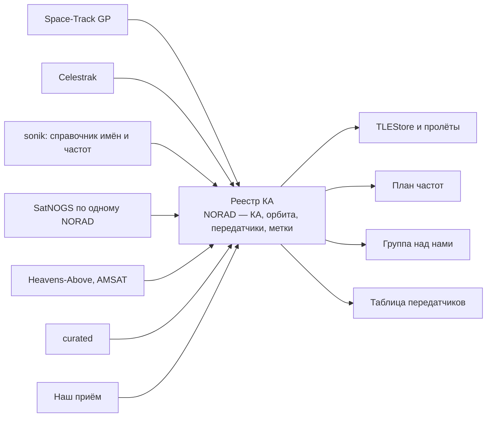

# ADR-011: Единый реестр КА и передатчиков

**Дата:** 2026-11-12
**Статус:** Accepted
**Ревизия:** 2026-11-12 — строгая живость и отсев высоких орбит (§2.4), sonik из основы каталога в справочник (§2.7)
**Связанные задачи:** TLE-SRC-001 (срезы 2–3), TX-DB-001 (хранилище), RX-STATS-001, CLASS-INFO-001
**Связанные ADR:**
- ADR-001 (Группа КА) — скользящее окно, primary и сопровождение остаются. Меняется только то, какие КА могут попасть в группу.
- ADR-004 (Тип станции) — диапазоны радиотрактов `radio_paths` задают метку «в диапазоне станции».

---

## 1. Контекст и проблема

### 1.1. Сейчас знания о КА разложены по разным местам

| Что | Откуда | Где лежит |
|-----|--------|-----------|
| Орбиты | Space-Track (каталог), Celestrak (по группам) | `data/tle_cache/catalog.tle`, `{group}.tle` |
| Состав каталога | sonik `/satellites/data/` (`in orbit` + `future`), группы Celestrak | только в памяти `TLEStore` |
| Передатчики | curated, Heavens-Above, AMSAT, SatNOGS по одному NORAD | `freq_curated.json`, `heavensabove_amateur.html`, `amsat_active.csv`, `satnogs_transmitters.json` |
| Группы | Celestrak `stations`, `amateur`, `cubesat` | `config.tle.groups` |

Каждый потребитель сам собирает нужный ему срез: план частот сливает источники передатчиков по приоритету (`freqplan.Merge`), группа «над нами» берёт все КА каталога, SatNOGS дёргается по каждому КА группы.

### 1.2. Что сломалось на большом каталоге (замер 2026-11-12)

- Каталог через Space-Track вырос со 196 до 1525 КА. Группа «над нами» выросла с единиц до ~67 КА.
- Ни один источник не отвечает на вопрос «этот КА стоит слушать моей станцией». В sonik передатчик со `status=active` есть у 1529 из 1653 КА на орбите, в том числе у OV3-3 1966 года. `total_obs` — счётчик приёмов за всё время, а не за последнее время.
- План частот разом ставит в очередь SatNOGS ~660 NORAD, очередь на 256 записей отбрасывает остальные.
- Группы Celestrak — чужая разбивка: в `cubesat` есть КА без любительских передатчиков, а часть любительских КА в группы не входит.

## 2. Решение

### 2.1. Реестр КА — одна таблица с ключом NORAD

Все источники пишут в реестр, все потребители (TLEStore, план частот, группа, таблица передатчиков, классификатор) читают из него. Каждое значение помнит свой источник и время получения.

### 2.2. Записи

| Запись | Поля |
|--------|------|
| КА | NORAD, имя, другие имена (sonik, SatNOGS, HA), статус (`in orbit`, `future`, `re-entered`, `dead`), источник статуса, позывной, оператор, дата запуска |
| Орбита | NORAD, строки TLE, эпоха, источник, время получения |
| Передатчик | uuid (у SatNOGS и sonik общий), NORAD, частота вниз и вверх, модуляция, скорость, статус, `alive`, источник, время получения |
| Приём | NORAD, uuid передатчика, время, что демодулировали — из `RX-STATS-001` |
| Загрузка источника | источник, время последней удачной и неудачной загрузки, ошибка |

### 2.3. Слияние: приоритет источников по полю

| Поле | Порядок |
|------|---------|
| Орбита | Space-Track, затем Celestrak; на руках остаётся более свежая эпоха |
| Статус КА | наш приём (слышали за 30 суток), SatNOGS — только `dead`, Heavens-Above и AMSAT (`active`), sonik — для карточки, живость не подтверждает |
| Передатчики | curated, Heavens-Above, AMSAT, sonik, SatNOGS — как сейчас в `freqplan.Merge`, плюс sonik bulk |
| Имя | curated, sonik, SatNOGS, Space-Track |

Совпадение передатчиков из разных источников — по uuid, иначе по NORAD и частоте в пределах 5 кГц (`freqplan.nearHz`).

### 2.4. Свои группы — метки из реестра

Группа Celestrak заменяется метками, которые вычисляются из полей реестра:

| Метка | Правило |
|-------|---------|
| В диапазоне станции | есть активный передатчик, который может настроить SDR хотя бы одного радиотракта (RTL-SDR — 24–1766 МГц) |
| Жив | слышали сами или есть у HA или AMSAT. Флаг SatNOGS `alive` ставят редакторы, к приёмам он не привязан (стоит у TIROS 10 1965 года), поэтому SatNOGS только признаёт КА мёртвым; подтверждение — хорошие наблюдения SatNOGS Network за 30 суток (срез 4) |
| Слышали | есть запись приёма |
| Станции | МКС, CSS и другие обитаемые |
| Погодные | передатчики APT/LRPT в 137 МГц |

Граница диапазона — у приёмника, а не у антенны. Квадрифиляр на 430–450 МГц принимает и 400, и 135 МГц, только с потерями, поэтому диапазон антенны (`antenna.freq_min_mhz`/`freq_max_mhz`) КА не отсекает. Он задаёт порядок: передатчик внутри диапазона антенны стоит выше передатчика за его краем. Замер 2026-11-12 по передатчикам sonik: 1009 КА в 24–1766 МГц, 906 — в 144–440 МГц.

КА с периодом больше 225 минут (граница SGP4 и SDP4: геостационарные, высокоэллиптические, навигационные) станция с RTL-SDR и всенаправленной антенной не слушает, в группу и План они не попадают. КА из curated — выбор оператора, для них метка «жив» не требуется.

Группа «над нами» (ADR-001) — пролёты в окне `[now, now + 1 мин]`, отобранные по метке. По умолчанию — «в диапазоне станции» и «жив»: диапазон сам по себе почти ничего не отсекает (1009 из 1525), основное сокращение даёт живость. Карта и пролёты продолжают видеть весь каталог. До среза 2 отбор временно стоит на самих пролётах (`passExcluder`), поэтому карта и План видят только отобранные КА.

### 2.5. Загрузка: сначала пачками, по одному — только пробелы

- Пачками: Space-Track GP (уже есть), sonik КА и передатчики как справочник (1,4 МБ за раз), Heavens-Above и AMSAT (уже есть).
- SatNOGS по одному NORAD — только для КА без передатчиков или без статуса, с паузой 1 с и новым соединением на запрос (большие ответы обрываются блокировкой). Очередь не переполняется, потому что в неё попадают только пробелы.

### 2.6. Хранение

`data/scout.db` (SQLite), который уже запланирован в `TX-DB-001` для статистики приёма. Драйвер без cgo, чтобы сборка оставалась кроссплатформенной. JSON-кеши источников остаются сырыми снимками ответов: по ним реестр восстанавливается без сети.

### 2.7. Состав каталога: источники живости, sonik — справочник

Каталог — набор NORAD, по которым Space-Track отдаёт элементы GP и даты схода SATCAT:

- curated, AMSAT, Heavens-Above;
- свежие запуски из sonik: статус `in orbit` или `future`, дата запуска не старше 60 суток (новые кубсаты почти всегда работают, а в AMSAT и Heavens-Above попадают позже);
- КА, подтверждённые хорошими наблюдениями SatNOGS Network за 30 суток (срез 4); кандидатов для проверки даёт sonik.

sonik остаётся справочником: имена, позывные, оператор, дата запуска, дополнительные частоты КА каталога, второй источник `re-entered`.

Почему. У sonik схема SatNOGS DB и нет признака живости: `status=active` стоит у передатчиков КА 1960-х годов. Взяли его как обход: выгрузка SatNOGS DB с нашей сети обрывается после ~16 КБ. Замер 2026-11-12: из 1525 КА каталога после отбора по живости в План попадает около 100. Остальные только удваивают запросы к Space-Track и расчёт пролётов. Группы Celestrak в состав не возвращаются: всё, что из них проходит отбор, уже есть у AMSAT или Heavens-Above. Если выгрузка SatNOGS DB станет доступна целиком, она заменяет sonik: это его первоисточник, и `alive` у передатчиков там есть.

## 3. Срезы перехода

1. Реестр в памяти и в `scout.db`, наполнение из уже существующих клиентов (Space-Track, sonik КА, кеши HA, AMSAT, SatNOGS, curated) и новый клиент sonik передатчиков. План частот читает передатчики из реестра через интерфейс `freqplan.Source`.
2. Метки и группа «над нами» по метке, выбор метки в настройках.
3. Удаление `tle.groups`: Celestrak остаётся запасным источником орбит по NORAD.
4. SatNOGS — догрузка пробелов и подтверждение живости по наблюдениям SatNOGS Network за 30 суток. Метка «слышали» после `RX-STATS-001`.
5. Состав каталога по §2.7: sonik перестаёт задавать набор NORAD для Space-Track.

## 4. Последствия

- Один ответ на вопрос «что известно про КА» для всех экранов и сервисов.
- Метки зависят от радиотрактов: при смене тракта метки пересчитываются, сеть не нужна.
- Старые группы в конфиге и подписи групп в UI уходят в срезе 3.

## 5. Решения по открытым вопросам (2026-11-12)

- **Сошедшие с орбиты КА.** Space-Track не отдаёт элементы сгоревшего КА, а реестр в этом случае хранит прежние: без статуса такой КА вечно летал бы по старой орбите. Статус берётся из каталога Space-Track SATCAT (дата `DECAY`) тем же клиентом и в том же проходе, что GP, пачками по NORAD; `re-entered` у sonik — второй источник. КА с `DECAY` из пролётов и группы уходит. Объём ответа SATCAT проверить в срезе 1.
- **Ручная правка карточки КА в UI** — не сейчас. Поправки идут через `data/freq_curated.json`, метка «слышали» появляется сама из статистики приёма. Интерфейс правки — отдельной задачей позже.
